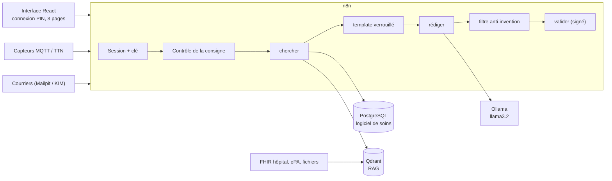

# AI-Care Assistant

Assistant IA pour les équipes soignantes d'une maison de soins en Allemagne, fonctionnant en local.

L'interface est hybride : aucun chat direct avec l'IA.

- **Mode A** : boutons qui envoient `{action, chambre}` à un webhook n8n (le prompt reste caché derrière le bouton).
- **Mode B** : le soignant choisit un résident (obligatoire) et écrit une consigne guidée ; n8n contrôle le texte puis l'insère dans un template verrouillé.
- Chaque réponse est modifiable, cite ses sources entre crochets et doit passer par **[Valider & Enregistrer]**.

Les données utilisées dans ce dépôt sont exclusivement fictives.

## Vue d'ensemble



Schémas détaillés, garanties et tests : [docs/architecture.md](docs/architecture.md). Bilan des quatre jours, chiffres et limites : [docs/RAPPORT.md](docs/RAPPORT.md).

**Ce qu'il faut savoir avant d'aller plus loin** : le texte de l'IA est toujours un brouillon ; un filtre codé retire toute phrase qui n'est pas appuyée par son fait, mais le soignant relit et valide. Avec le petit modèle de ce poste (`llama3.2`, sans carte graphique), un texte prend 2 à 5 minutes et la batterie de 30 questions donne 25/30 mesuré (17/30 avant les corrections de l'étape 9 ; voir [docs/batterie.md](docs/batterie.md)).

## Sources d'intelligence

Logiciel de soins, base de données de l'hôpital (FHIR), fichiers, capteurs, Télématique Infrastructure (système de santé allemand) et RAG (Qdrant). Le RAG n'est qu'une source parmi d'autres.

## Documentation

- [Schéma du RAG : collections Qdrant et payloads](docs/schema-rag.md)
- [Briques IA : chercher, template verrouillé, rédiger, enregistrer, journal](docs/briques-ia.md)
- [Interface reliée à n8n : contrat, parcours, garanties, rapport de garde d'un étage et transmission](docs/interface-n8n.md)
- [Prompts versionnés (7 prompts, 21 cas de test)](prompts/README.md)
- [Essais des prompts avec le vrai modèle](docs/prompts-tests.md)
- [Données de test](data/README.md)
- [Alarmes de capteurs (MQTT) : sujets, délais, réglages](docs/alarmes.md)
- [Documents en automatique : courriers, OCR, identification, validation, ePA](docs/documents.md)
- [Installer le projet sur un autre poste et rejouer les tests](docs/INSTALLATION.md)
- [Cotisations retraite des aidants familiaux : agent, webhooks, tables, tests](docs/cotisations.md)
- [Vitesse : mesures avant / après](docs/vitesse.md)
- [Sécurité : connexion du soignant, sessions, clés, limites](docs/securite.md)
- [Batterie de tests : 30 questions, consignes malveillantes, homonymes, panne, temps de réponse](docs/batterie.md)
- [Architecture : schémas, garanties, services](docs/architecture.md)
- [Rapport des jours 1 à 4 : résultats, erreurs, limites](docs/RAPPORT.md)
- [Dernière démonstration (nuit fictive)](docs/demo-derniere.md)
- [Décisions techniques](DECISIONS.md)

## Structure

| Dossier | Contenu |
|---|---|
| `front/` | Interface React (Vite) |
| `compose/` | Socle docker-compose |
| `data/` | Données fictives |
| `prompts/` | Prompts et templates verrouillés |
| `workflows/` | Workflows n8n exportés |
| `docs/` | Documentation |
| `tests/` | Tests |

## Prérequis

Git, Node.js LTS, Docker Desktop (avec Docker Compose).

## Mise en route complète (pile vierge)

**Installation guidée en une commande : `node scripts/installer.mjs --modeles`**, puis `node scripts/installer.mjs --verifier`. Guide pour un autre poste, durées des tests et dépannage : [docs/INSTALLATION.md](docs/INSTALLATION.md). Les étapes manuelles ci-dessous font la même chose.

Dans l'ordre, depuis la racine du projet. Compter environ 25 minutes sur un poste de 8 Go (l'import des workflows est lent).

1. **Secrets** : `cp .env.exemple .env`, puis les créer au hasard (aucune valeur n'est écrite dans le dépôt) :

```bash
node scripts/generer-secrets.mjs
```

2. **Services Docker** :

```bash
cd compose
```
```bash
docker compose up -d
```

3. **Modèles Ollama** (sur le poste, voir plus bas) : `llama3.2` et `nomic-embed-text`.
4. **Données fictives et Qdrant** : `cd data`, `npm install`, `npm run tout`, `npm run qdrant` (voir « Workflows n8n »).
5. **Workflows n8n** (crée aussi les credentials, publie les déclencheurs, redémarre n8n ; environ 15 minutes) :

```bash
node workflows/importer.mjs
```

6. **Comptes des soignants** (codes PIN dans `.env`) :

```bash
node scripts/creer-soignants.mjs
```

7. **Interface** : voir « Interface (front) » ; mettre `VITE_MOCK=false` dans `.env` pour utiliser n8n.
8. **Indexer le RAG** une première fois (sinon attendre 06:00) : `node tests/test-du-soir.mjs 1`.
9. **Démonstration** : voir plus bas.

### Démonstration : une nuit fictive

Rejoue de bout en bout une nuit de la maison Sonnenhof, avec le compte `arsene` (ou `AICARE_COMPTE_TEST=martin`) :

```bash
node scripts/demo-nuit.mjs
```

Scènes : connexion par PIN ; 02 h 10 alarme de chute chambre 12 (capteur MQTT) ; 03 h 30 lettre de médecin dans la boîte KIM (OCR, identification d'un Müller par nom et date de naissance) ; rapport de garde et question libre (Llama, 3 à 10 minutes) ; consigne malveillante refusée avant toute IA ; validation signée par le compte connecté ; contrôle « aucune phrase sans source ». Sans Llama (moins de 5 minutes, sauf si d'anciens travaux de fond tournent encore) : `node scripts/demo-nuit.mjs --rapide`. Le résultat est écrit dans [docs/demo-derniere.md](docs/demo-derniere.md).

Avant une démonstration, recharger les horodatages (les « 12 dernières heures » vieillissent) : `cd data && npm run postgres`.

**Repartir d'une pile entièrement vierge** (efface les volumes Docker : base, Qdrant, n8n, comptes) :

```bash
cd compose
```
```bash
docker compose down -v
```

puis reprendre les étapes 2 à 9. Le script de démonstration ne fait pas cette remise à zéro lui-même : elle détruit des données et se décide à la main.

### Ollama (Llama)

Ollama n'est pas dans le docker-compose : on réutilise celui installé sur le poste (port 11434), afin de ne pas avoir deux copies du modèle. Les conteneurs l'appellent via `http://host.docker.internal:11434`. Le modèle de rédaction est `llama3.2` (réglage `AICARE_MODELE`). Installer les modèles sur le poste :

```bash
ollama pull llama3.2
```

```bash
ollama pull nomic-embed-text
```

> Pour un serveur sans Ollama installé, ajouter un service `ollama` au compose et lancer ces deux commandes avec `docker compose exec ollama ollama pull …`.

### Adresses (poste → conteneur)

| Service | Depuis le poste | Depuis un conteneur |
|---|---|---|
| n8n | http://localhost:5679 | http://n8n:5678 |
| Qdrant | http://localhost:6335 | http://qdrant:6333 |
| Mosquitto (MQTT) | localhost:1884 | mosquitto:1883 |
| Mailpit (interface) | http://localhost:8025 | mailpit:1025 |
| HAPI FHIR | http://localhost:8090/fhir | http://hapi-fhir:8080/fhir |
| PostgreSQL | — | postgres:5432 |
| Ollama | http://localhost:11434 | http://host.docker.internal:11434 |
| ePA – médication (FHIR) | http://localhost:8084/fhir | http://host.docker.internal:8084/fhir |
| ePA – rendu de l'eML | http://localhost:8085 | http://host.docker.internal:8085 |
| ePA – information | http://localhost:8082 | http://host.docker.internal:8082 |

### Test Llama 3 via n8n

Importer `workflows/test-llama3.json` (déjà fait par la commande ci-dessous), puis :

```bash
docker compose exec n8n n8n import:workflow --input=/tmp/test-llama3.json
```

```bash
curl -X POST http://localhost:5679/webhook/test-llama3
```

La réponse est un JSON `{"reponse": "..."}` généré par Llama 3. Llama 3 (8B) demande environ 5 Go de mémoire libre.

### Télématique Infrastructure (système de santé allemand) de test : ePA de gematik

Les mocks officiels de gematik simulent l'ePA (dossier patient électronique). Dépôt tiers, ignoré par Git :

```bash
cd compose
```
```bash
git clone https://github.com/gematik/epa-deployment
```

> Si `git clone` est bloqué sur le poste, télécharger l'archive https://codeload.github.com/gematik/epa-deployment/zip/refs/heads/main et l'extraire dans `compose/epa-deployment/`.

Démarrage **allégé** (3 services, ~1,5 Go de RAM) : service de médication (FHIR), rendu de l'eML et service d'information. Le fichier `epa-mocks.override.yml` plafonne la mémoire de chaque JVM et agrandit la page de résultats FHIR :

```bash
docker compose -f epa-deployment/dc-mocks.yml -f epa-mocks.override.yml up -d medication-service medication-render-service information-service
```

Le service de médication met environ 5 minutes à démarrer. Ensuite, charger l'ePA des résidents fictifs :

```bash
cd ../data
```
```bash
npm run epa
```

Lire l'eML d'un résident (M. Weber, KVNR fictif Z000000012) :

```bash
curl -H "x-insurantid: Z000000012" -H "Accept: text/html" http://localhost:8085/epa/medication/render/v1/eml/xhtml
```

Démarrage **complet** de gematik (ajoute tiger-proxy sur le port 443, vau-proxy, authorization, entitlement ; ~4 Go de RAM au total) : `docker compose -f epa-deployment/dc-mocks.yml -f epa-mocks.override.yml up -d`.
La KIM reste simulée par Mailpit.
## Workflows n8n (connecteurs vers les sources d'intelligence)

Les workflows sont dans `workflows/` (JSON versionnés, générés depuis `workflows/code/*.js`) :

| Fichier | Rôle |
|---|---|
| `00-indexeur.json` | sous-workflow commun : découpage 300–500 mots, embedding `nomic-embed-text`, écriture dans Qdrant |
| `10-connecteur-logiciel-soins.json` | notes de soins et fiches résidents (PostgreSQL) |
| `20-connecteur-fhir-hopital.json` | base de l'hôpital (HAPI FHIR) |
| `30-connecteur-fichiers.json` | `data/fichiers/` (protocoles, documents scannés par OCR) |
| `40-connecteur-epa.json` | ePA de test (diagnostics et eML) |
| `50-connecteur-kim.json` | boîte KIM simulée (lettres de médecin, avec OCR) vers la collection `a_verifier` |

Préparer, puis importer dans n8n (le credential PostgreSQL est créé depuis le `.env`) :

```bash
cd compose
```
```bash
docker compose up -d
```
```bash
cd ../data
```
```bash
npm run tout && npm run qdrant
```
```bash
cd ..
```
```bash
node workflows/importer.mjs
```

Lancer un connecteur à la main (réponse : nombre de morceaux indexés) :

```bash
curl -X POST http://localhost:5679/webhook/import-soins
```

**Planification automatique : 4 fois par jour** (00:00, 06:00, 12:00 et 18:00, heure de Berlin ; soins à :00, FHIR à :10, fichiers à :20, ePA à :30, KIM à :40). L'anti-doublon (empreinte SHA-256) et le journal `soins.journal_imports` évitent de ré-importer ce qui n'a pas changé.

Webhooks (import à la demande) : `import-soins`, `import-fhir`, `import-fichiers`, `import-epa`, `import-kim`. Après une modification de `workflows/code/`, régénérer avec `node workflows/generer.mjs` puis réimporter. Test hors n8n du découpage : `node tests/indexeur-decoupage.test.mjs`. Test du soir (3 passages, aucun doublon, recherche « M. Weber chute ») : `node tests/test-du-soir.mjs`.
## Interface (front)

```bash
cd front
```
```bash
npm install
```
```bash
npm run dev
```

Puis ouvrir http://localhost:5173 (ou l'adresse « Network » affichée, depuis une tablette). Tous les textes sont dans `front/src/i18n/fr.json`.

**Connexion.** L'interface s'ouvre sur une page de connexion (identifiant + code PIN). En mode simulé (par défaut) : identifiant `demo`, code PIN `123456`. Avec n8n (`VITE_MOCK=false` dans `.env`) : comptes fictifs `martin`, `keller`, `roth`, dont les PIN sont dans `.env` (`DEMO_PIN_*`). Première mise en route de la sécurité :

```bash
node scripts/generer-secrets.mjs
```
```bash
node scripts/creer-soignants.mjs
```
```bash
node workflows/importer.mjs
```

Détail, limites : [docs/securite.md](docs/securite.md).

**Créer un compte soignant** (identifiant + PIN), sans toucher au code : `node scripts/creer-compte.mjs` (mode guidé). Changer un PIN, désactiver un compte, lister : voir [docs/securite.md](docs/securite.md#créer-et-gérer-les-comptes).


## Cotisations retraite des aidants familiaux (démonstration)

4e page de l'interface : un agent IA traite les questionnaires des aidants familiaux (cotisations retraite payées par la caisse de dépendance, § 3 et § 166 SGB VI, § 44 SGB XI). **Données entièrement fictives.** Fonctionne en mode simulé (`VITE_MOCK=true`) et **de bout en bout par n8n** (`VITE_MOCK=false` : 6 webhooks, tâche de fond, PostgreSQL, journal, dépôt de fichiers, lecture facultative par llama3.2) : voir [docs/cotisations.md](docs/cotisations.md).

| Fichier | Rôle |
|---|---|
| `workflows/code/sgb6/regles.js` | Moteur de règles en JavaScript pur : lecture du questionnaire, contrôle des champs (numéro d'assurance retraite avec son chiffre de contrôle), règles R1 à R6, calcul, brouillon de déclaration |
| `data/sgb6/valeurs-legales.json` | Bezugsgröße, taux et pourcentages par année (une année absente = erreur, jamais de valeur par défaut) |
| `data/sgb6/caisse.json`, `questionnaires/*.txt`, `attendus.json` | Caisse simulée, 9 questionnaires fictifs, résultat attendu de chacun |
| `front/src/components/PageCotisations.jsx` | La page : dossiers, étapes de l'agent, règles, calcul, déclaration, décision humaine |

L'agent ne valide et ne refuse jamais seul : « Valider » (toutes les règles ok), « Créer une tâche de revue » et « Refuser » (motif obligatoire, après une exception) sont réservés à la personne. Captures : `docs/captures/cotisations-*.jpg`. Tests : `node --test tests/sgb6-regles.test.mjs tests/sgb6-attendus.test.mjs`, `node tests/sgb6-n8n.test.mjs`, et avec n8n démarré `node tests/sgb6-live.mjs` (`--ia` pour la lecture par l'IA, 20 à 40 minutes).

## Tests

Sans IA (instantanés) :

```bash
node tests/briques.test.mjs        # briques : template, contrôle de la réponse, enregistrer
```
```bash
node tests/prompts.test.mjs        # 7 prompts, 21 cas, réponses de référence
```
```bash
node tests/consigne.test.mjs       # contrôle de la consigne du Mode B
```
```bash
node tests/regles.test.mjs         # filet de règles des contradictions
```
```bash
node tests/chemins-ia.test.mjs     # aucun chemin du texte du soignant vers l'IA sans contrôle
```
```bash
node tests/apres-validation.test.mjs   # rapport d'étage, ajout au RAG et transmission après validation
```
```bash
node tests/taches.test.mjs             # tâches de fond : battement de coeur, annulation, reprise au démarrage
```
```bash
node tests/courriers.test.mjs          # documents en automatique : identification, alertes, validation, rattrapage
```
```bash
node tests/alarmes.test.mjs            # alarmes de capteurs : sujet, faits codés, ordre des étapes
```
```bash
node tests/i18n.test.mjs               # textes de l'interface : pas de clé en double, aucune clé manquante
```
```bash
node tests/securite.test.mjs          # sécurité : session avant tout traitement, PIN haché, signature, aucun secret dans le dépôt
```
```bash
node tests/anti-invention.test.mjs     # filtre anti-invention : fausses réponses du modèle, aucune phrase non sourcée ne passe
```
```bash
node tests/pertinence.test.mjs         # « chercher » : faits classés selon la demande, « information non disponible » si le dossier n'en parle pas
```

**Batterie complète (étape 8)** : `node tests/batterie.mjs` (partie rapide, sans IA, quelques minutes) puis `node tests/batterie.mjs --reel` (30 questions avec Llama, environ 75 minutes, reprenable avec `--reprendre`). Résultats lisibles dans `tests/resultats/batterie-derniere.md`. Détail : [docs/batterie.md](docs/batterie.md).

Avec les services démarrés : `node tests/test-du-soir.mjs` (indexation, sans doublon). Avec le vrai modèle (lent) : `node tests/prompts-live.mjs`, et `node tests/alarme-live.mjs` pour les alarmes de capteurs (MQTT, délais), `node tests/taches-live.mjs` pour les tâches de fond, `node tests/securite-live.mjs` pour la sécurité contre n8n (clé, session, verrouillage, CORS, signature), et `node tests/etage-live.mjs 2` pour le rapport de garde d'un étage jusqu'à la transmission (10 à 25 minutes).

Après une retouche d'un workflow, `node workflows/generer.mjs` puis `node workflows/importer.mjs --seulement=66,74` (numéros des workflows à réimporter).

## Décisions techniques

Voir [DECISIONS.md](DECISIONS.md).
