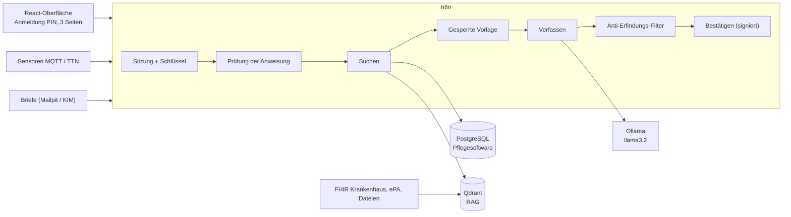

# AI-Care Assistant

KI-Assistent für die Pflegeteams einer Pflegeeinrichtung in Deutschland, der lokal läuft.

Die Oberfläche ist hybrid: kein direkter Chat mit der KI.

- **Modus A**: Schaltflächen, die `{action, chambre}` an einen n8n-Webhook senden (der Prompt bleibt hinter der Schaltfläche verborgen).
- **Modus B**: Die Pflegekraft wählt eine Bewohnerin bzw. einen Bewohner (Pflicht) und schreibt eine geführte Anweisung; n8n prüft den Text und fügt ihn dann in ein gesperrtes Template ein.
- Jede Antwort ist bearbeitbar, nennt ihre Quellen in eckigen Klammern und muss über **[Bestätigen & Speichern]** laufen.

Die in diesem Repository verwendeten Daten sind ausschließlich fiktiv.

## Überblick



Detaillierte Schemata, Garantien und Tests: [docs/architecture.md](docs/architecture.md). Bilanz der vier Tage, Zahlen und Grenzen: [docs/RAPPORT.md](docs/RAPPORT.md).

**Was man wissen sollte, bevor man weitergeht**: Der Text der KI ist immer ein Entwurf; ein programmierter Filter entfernt jeden Satz, der nicht durch seinen Fakt gestützt ist, aber die Pflegekraft liest und validiert. Mit dem kleinen Modell dieses Rechners (`llama3.2`, ohne Grafikkarte) dauert ein Text 2 bis 5 Minuten, und die Batterie von 30 Fragen ergibt gemessene 25/30 (17/30 vor den Korrekturen von Schritt 9; siehe [docs/batterie.md](docs/batterie.md)).

## Intelligenzquellen

Pflegesoftware, Krankenhausdatenbank (FHIR), Dateien, Sensoren, Telematikinfrastruktur (Gesundheitswesen in Deutschland) und RAG (Qdrant). Das RAG ist nur eine Quelle unter mehreren.

## Dokumentation

- [Schema des RAG: Qdrant-Collections und Payloads](docs/schema-rag.md)
- [KI-Bausteine: Suchen, gesperrte Vorlage, Verfassen, Speichern, Protokoll](docs/briques-ia.md)
- [Mit n8n verbundene Oberfläche: Vertrag, Ablauf, Garantien, Dienstbericht einer Etage und Übermittlung](docs/interface-n8n.md)
- [Versionierte Prompts (7 Prompts, 21 Testfälle)](prompts/README.md)
- [Praxistests der Prompts mit dem echten Modell](docs/prompts-tests.md)
- [Testdaten](data/README.md)
- [Sensoralarme (MQTT): Themen, Fristen, Einstellungen](docs/alarmes.md)
- [Dokumente automatisch: Briefe, OCR, Identifizierung, Validierung, ePA](docs/documents.md)
- [Das Projekt auf einem anderen Rechner installieren und die Tests wiederholen](docs/INSTALLATION.md)
- [Rentenbeiträge pflegender Angehöriger: Agent, Webhooks, Tabellen, Tests](docs/cotisations.md)
- [Geschwindigkeit: Messungen vorher / nachher](docs/vitesse.md)
- [Sicherheit: Anmeldung der Pflegekraft, Sitzungen, Schlüssel, Grenzen](docs/securite.md)
- [Testbatterie: 30 Fragen, bösartige Anweisungen, Namensvettern, Ausfall, Antwortzeit](docs/batterie.md)
- [Architektur: Schemata, Garantien, Dienste](docs/architecture.md)
- [Bericht der Tage 1 bis 4: Ergebnisse, Fehler, Grenzen](docs/RAPPORT.md)
- [Letzte Demonstration (fiktive Nacht)](docs/demo-derniere.md)
- [Technische Entscheidungen](DECISIONS.md)

## Struktur

| Ordner | Inhalt |
|---|---|
| `front/` | React-Oberfläche (Vite) |
| `compose/` | docker-compose-Basis |
| `data/` | Fiktive Daten |
| `prompts/` | Prompts und gesperrte Templates |
| `workflows/` | Exportierte n8n-Workflows |
| `docs/` | Dokumentation |
| `tests/` | Tests |

## Voraussetzungen

Git, Node.js LTS, Docker Desktop (mit Docker Compose).

## Vollständige Inbetriebnahme (leerer Stack)

**Geführte Installation mit einem Befehl: `node scripts/installer.mjs --modeles`**, danach `node scripts/installer.mjs --verifier`. Anleitung für einen anderen Rechner, Dauer der Tests und Fehlerbehebung: [docs/INSTALLATION.md](docs/INSTALLATION.md). Die manuellen Schritte unten tun dasselbe.

In dieser Reihenfolge, vom Projektstamm aus. Auf einem Rechner mit 8 GB etwa 25 Minuten einplanen (der Import der Workflows ist langsam).

1. **Secrets**: `cp .env.exemple .env`, dann zufällig erzeugen (im Repository wird kein Wert gespeichert):

```bash
node scripts/generer-secrets.mjs
```

2. **Docker-Dienste**:

```bash
cd compose
```
```bash
docker compose up -d
```

3. **Ollama-Modelle** (auf dem Rechner, siehe weiter unten): `llama3.2` und `nomic-embed-text`.
4. **Fiktive Daten und Qdrant**: `cd data`, `npm install`, `npm run tout`, `npm run qdrant` (siehe « Workflows n8n »).
5. **n8n-Workflows** (legt auch die Credentials an, veröffentlicht die Trigger, startet n8n neu; etwa 15 Minuten):

```bash
node workflows/importer.mjs
```

6. **Konten der Pflegekräfte** (PIN-Codes in `.env`):

```bash
node scripts/creer-soignants.mjs
```

7. **Oberfläche**: siehe « Oberfläche (Front) »; `VITE_MOCK=false` in `.env` setzen, um n8n zu verwenden.
8. **Das RAG erstmals indexieren** (sonst bis 06:00 warten): `node tests/test-du-soir.mjs 1`.
9. **Demonstration**: siehe weiter unten.

### Demonstration: eine fiktive Nacht

Spielt eine Nacht im Haus Sonnenhof von Anfang bis Ende nach, mit dem Konto `arsene` (oder `AICARE_COMPTE_TEST=martin`):

```bash
node scripts/demo-nuit.mjs
```

Szenen: Anmeldung per PIN; 02:10 Sturzalarm in Zimmer 12 (MQTT-Sensor); 03:30 Arztbrief im KIM-Postfach (OCR, Identifizierung eines Müller anhand von Name und Geburtsdatum); Dienstbericht und freie Frage (Llama, 3 bis 10 Minuten); bösartige Anweisung vor jeder KI abgelehnt; signierte Validierung durch das angemeldete Konto; Kontrolle « kein Satz ohne Quelle ». Ohne Llama (weniger als 5 Minuten, außer wenn noch alte Hintergrundaufgaben laufen): `node scripts/demo-nuit.mjs --rapide`. Das Ergebnis wird in [docs/demo-derniere.md](docs/demo-derniere.md) geschrieben.

Vor einer Demonstration die Zeitstempel neu laden (die « letzten 12 Stunden » veralten): `cd data && npm run postgres`.

**Von einem vollständig leeren Stack neu beginnen** (löscht die Docker-Volumes: Datenbank, Qdrant, n8n, Konten):

```bash
cd compose
```
```bash
docker compose down -v
```

danach die Schritte 2 bis 9 wiederholen. Das Demonstrationsskript führt diese Rücksetzung nicht selbst durch: Sie zerstört Daten und wird von Hand entschieden.

### Ollama (Llama)

Ollama ist nicht im docker-compose enthalten: Es wird die auf dem Rechner installierte Instanz (Port 11434) wiederverwendet, um nicht zwei Kopien des Modells zu haben. Die Container rufen es über `http://host.docker.internal:11434` auf. Das Modell für die Textgenerierung ist `llama3.2` (Einstellung `AICARE_MODELE`). Die Modelle auf dem Rechner installieren:

```bash
ollama pull llama3.2
```

```bash
ollama pull nomic-embed-text
```

> Für einen Server ohne installiertes Ollama einen Dienst `ollama` zum Compose hinzufügen und diese beiden Befehle mit `docker compose exec ollama ollama pull …` ausführen.

### Adressen (Rechner → Container)

| Dienst | Vom Rechner aus | Aus einem Container |
|---|---|---|
| n8n | http://localhost:5679 | http://n8n:5678 |
| Qdrant | http://localhost:6335 | http://qdrant:6333 |
| Mosquitto (MQTT) | localhost:1884 | mosquitto:1883 |
| Mailpit (Oberfläche) | http://localhost:8025 | mailpit:1025 |
| HAPI FHIR | http://localhost:8090/fhir | http://hapi-fhir:8080/fhir |
| PostgreSQL | — | postgres:5432 |
| Ollama | http://localhost:11434 | http://host.docker.internal:11434 |
| ePA – Medikation (FHIR) | http://localhost:8084/fhir | http://host.docker.internal:8084/fhir |
| ePA – Darstellung der eML | http://localhost:8085 | http://host.docker.internal:8085 |
| ePA – Information | http://localhost:8082 | http://host.docker.internal:8082 |

### Test von Llama 3 über n8n

`workflows/test-llama3.json` importieren (bereits durch den folgenden Befehl erledigt), dann:

```bash
docker compose exec n8n n8n import:workflow --input=/tmp/test-llama3.json
```

```bash
curl -X POST http://localhost:5679/webhook/test-llama3
```

Die Antwort ist ein von Llama 3 erzeugtes JSON `{"reponse": "..."}`. Llama 3 (8B) benötigt etwa 5 GB freien Arbeitsspeicher.

### Test-Telematikinfrastruktur (Gesundheitswesen in Deutschland): ePA von gematik

Die offiziellen Mocks von gematik simulieren die ePA (elektronische Patientenakte). Drittanbieter-Repository, von Git ignoriert:

```bash
cd compose
```
```bash
git clone https://github.com/gematik/epa-deployment
```

> Ist `git clone` auf dem Rechner blockiert, das Archiv https://codeload.github.com/gematik/epa-deployment/zip/refs/heads/main herunterladen und in `compose/epa-deployment/` entpacken.

**Schlanker** Start (3 Dienste, ~1,5 GB RAM): Medikationsdienst (FHIR), Darstellung der eML und Informationsdienst. Die Datei `epa-mocks.override.yml` begrenzt den Speicher jeder JVM und vergrößert die FHIR-Ergebnisseite:

```bash
docker compose -f epa-deployment/dc-mocks.yml -f epa-mocks.override.yml up -d medication-service medication-render-service information-service
```

Der Medikationsdienst braucht etwa 5 Minuten zum Starten. Danach die ePA der fiktiven Bewohner laden:

```bash
cd ../data
```
```bash
npm run epa
```

Die eML einer Bewohnerin bzw. eines Bewohners lesen (Herr Weber, fiktive KVNR Z000000012):

```bash
curl -H "x-insurantid: Z000000012" -H "Accept: text/html" http://localhost:8085/epa/medication/render/v1/eml/xhtml
```

**Vollständiger** Start von gematik (fügt tiger-proxy auf Port 443, vau-proxy, authorization, entitlement hinzu; insgesamt ~4 GB RAM): `docker compose -f epa-deployment/dc-mocks.yml -f epa-mocks.override.yml up -d`.
KIM bleibt durch Mailpit simuliert.
## n8n-Workflows (Konnektoren zu den Intelligenzquellen)

Die Workflows liegen in `workflows/` (versionierte JSON-Dateien, erzeugt aus `workflows/code/*.js`):

| Datei | Aufgabe |
|---|---|
| `00-indexeur.json` | gemeinsamer Unter-Workflow: Aufteilung in 300–500 Wörter, Embedding `nomic-embed-text`, Schreiben in Qdrant |
| `10-connecteur-logiciel-soins.json` | Pflegenotizen und Bewohnerakten (PostgreSQL) |
| `20-connecteur-fhir-hopital.json` | Krankenhausdatenbank (HAPI FHIR) |
| `30-connecteur-fichiers.json` | `data/fichiers/` (Protokolle, per OCR gelesene Dokumente) |
| `40-connecteur-epa.json` | Test-ePA (Diagnosen und eML) |
| `50-connecteur-kim.json` | simuliertes KIM-Postfach (Arztbriefe, mit OCR) in die Collection `a_verifier` |

Vorbereiten, dann in n8n importieren (das PostgreSQL-Credential wird aus der `.env` angelegt):

```bash
cd compose
```
```bash
docker compose up -d
```
```bash
cd ../data
```
```bash
npm run tout && npm run qdrant
```
```bash
cd ..
```
```bash
node workflows/importer.mjs
```

Einen Konnektor von Hand starten (Antwort: Anzahl der indexierten Abschnitte):

```bash
curl -X POST http://localhost:5679/webhook/import-soins
```

**Automatische Planung: 4-mal täglich** (00:00, 06:00, 12:00 und 18:00, Berliner Zeit; Pflege um :00, FHIR um :10, Dateien um :20, ePA um :30, KIM um :40). Die Duplikatsperre (SHA-256-Fingerabdruck) und das Journal `soins.journal_imports` verhindern, dass Unverändertes erneut importiert wird.

Webhooks (Import auf Abruf): `import-soins`, `import-fhir`, `import-fichiers`, `import-epa`, `import-kim`. Nach einer Änderung in `workflows/code/` mit `node workflows/generer.mjs` neu erzeugen und erneut importieren. Test der Aufteilung außerhalb von n8n: `node tests/indexeur-decoupage.test.mjs`. Abendtest (3 Durchläufe, keine Duplikate, Suche « Herr Weber Sturz »): `node tests/test-du-soir.mjs`.
## Oberfläche (Front)

```bash
cd front
```
```bash
npm install
```
```bash
npm run dev
```

Dann http://localhost:5173 öffnen (oder die angezeigte « Network »-Adresse, von einem Tablet aus). Alle Texte stehen in `front/src/i18n/de.json`.

**Anmeldung.** Die Oberfläche öffnet sich mit einer Anmeldeseite (Kennung + PIN-Code). Im simulierten Modus (Standard): Kennung `demo`, PIN-Code `123456`. Mit n8n (`VITE_MOCK=false` in `.env`): fiktive Konten `martin`, `keller`, `roth`, deren PINs in `.env` stehen (`DEMO_PIN_*`). Erste Inbetriebnahme der Sicherheit:

```bash
node scripts/generer-secrets.mjs
```
```bash
node scripts/creer-soignants.mjs
```
```bash
node workflows/importer.mjs
```

Details, Grenzen: [docs/securite.md](docs/securite.md).

**Ein Pflegekraft-Konto anlegen** (Kennung + PIN), ohne den Code anzufassen: `node scripts/creer-compte.mjs` (geführter Modus). PIN ändern, Konto deaktivieren, auflisten: siehe [docs/securite.md](docs/securite.md#konten-anlegen-und-verwalten).


## Rentenbeiträge pflegender Angehöriger (Demonstration)

4. Seite der Oberfläche: Ein KI-Agent bearbeitet die Fragebögen pflegender Angehöriger (Rentenbeiträge, die von der Pflegekasse gezahlt werden, § 3 und § 166 SGB VI, § 44 SGB XI). **Vollständig fiktive Daten.** Funktioniert im simulierten Modus (`VITE_MOCK=true`) und **durchgängig über n8n** (`VITE_MOCK=false`: 6 Webhooks, Hintergrundaufgabe, PostgreSQL, Journal, Dateiablage, optionales Lesen durch llama3.2): siehe [docs/cotisations.md](docs/cotisations.md).

| Datei | Aufgabe |
|---|---|
| `workflows/code/sgb6/regles.js` | Regelwerk in reinem JavaScript: Lesen des Fragebogens, Prüfung der Felder (Rentenversicherungsnummer mit ihrer Prüfziffer), Regeln R1 bis R6, Berechnung, Entwurf der Meldung |
| `data/sgb6/valeurs-legales.json` | Bezugsgröße, Beitragssätze und Prozentsätze je Jahr (ein fehlendes Jahr = Fehler, niemals ein Standardwert) |
| `data/sgb6/caisse.json`, `questionnaires/*.txt`, `attendus.json` | Simulierte Kasse, 9 fiktive Fragebögen, erwartetes Ergebnis jedes einzelnen |
| `front/src/components/PageCotisations.jsx` | Die Seite: Vorgänge, Schritte des Agenten, Regeln, Berechnung, Meldung, menschliche Entscheidung |

Der Agent validiert oder lehnt niemals allein ab: « Meldung bestätigen » (alle Regeln ok), « Prüfaufgabe erstellen » und « Ablehnen » (Begründung Pflicht, nach einer Ausnahme) sind der Person vorbehalten. Screenshots: `docs/captures/cotisations-*.jpg`. Tests: `node --test tests/sgb6-regles.test.mjs tests/sgb6-attendus.test.mjs`, `node tests/sgb6-n8n.test.mjs`, und bei gestartetem n8n `node tests/sgb6-live.mjs` (`--ia` für das Lesen durch die KI, 20 bis 40 Minuten).

## Tests

Ohne KI (sofort):

```bash
node tests/briques.test.mjs        # Bausteine: Template, Kontrolle der Antwort, Speichern
```
```bash
node tests/prompts.test.mjs        # 7 Prompts, 21 Fälle, Referenzantworten
```
```bash
node tests/consigne.test.mjs       # Kontrolle der Anweisung in Modus B
```
```bash
node tests/regles.test.mjs         # Regelnetz für Widersprüche
```
```bash
node tests/chemins-ia.test.mjs     # kein Weg vom Text der Pflegekraft zur KI ohne Kontrolle
```
```bash
node tests/apres-validation.test.mjs   # Etagenbericht, Aufnahme ins RAG und Übermittlung nach der Validierung
```
```bash
node tests/taches.test.mjs             # Hintergrundaufgaben: Herzschlag, Abbruch, Wiederaufnahme beim Start
```
```bash
node tests/courriers.test.mjs          # Dokumente automatisch: Identifizierung, Warnungen, Validierung, Nachholen
```
```bash
node tests/alarmes.test.mjs            # Sensoralarme: Thema, codierte Fakten, Reihenfolge der Schritte
```
```bash
node tests/i18n.test.mjs               # Texte der Oberfläche: kein doppelter Schlüssel, kein fehlender Schlüssel
```
```bash
node tests/securite.test.mjs          # Sicherheit: Sitzung vor jeder Verarbeitung, gehashte PIN, Signatur, kein Secret im Repository
```
```bash
node tests/anti-invention.test.mjs     # Anti-Erfindungs-Filter: falsche Antworten des Modells, kein Satz ohne Quelle gelangt durch
```
```bash
node tests/pertinence.test.mjs         # « Suchen »: nach der Anfrage geordnete Fakten, « Information nicht verfügbar », wenn die Akte das Thema nicht behandelt
```

**Vollständige Batterie (Schritt 8)**: `node tests/batterie.mjs` (schneller Teil, ohne KI, einige Minuten), danach `node tests/batterie.mjs --reel` (30 Fragen mit Llama, etwa 75 Minuten, mit `--reprendre` fortsetzbar). Lesbare Ergebnisse in `tests/resultats/batterie-derniere.md`. Details: [docs/batterie.md](docs/batterie.md).

Mit gestarteten Diensten: `node tests/test-du-soir.mjs` (Indexierung, ohne Duplikate). Mit dem echten Modell (langsam): `node tests/prompts-live.mjs`, und `node tests/alarme-live.mjs` für Sensoralarme (MQTT, Fristen), `node tests/taches-live.mjs` für die Hintergrundaufgaben, `node tests/securite-live.mjs` für die Sicherheit gegenüber n8n (Schlüssel, Sitzung, Sperrung, CORS, Signatur) und `node tests/etage-live.mjs 2` für den Dienstbericht einer Etage bis zur Übermittlung (10 bis 25 Minuten).

Nach der Änderung eines Workflows `node workflows/generer.mjs`, dann `node workflows/importer.mjs --seulement=66,74` (Nummern der erneut zu importierenden Workflows).

## Technische Entscheidungen

Siehe [DECISIONS.md](DECISIONS.md).
