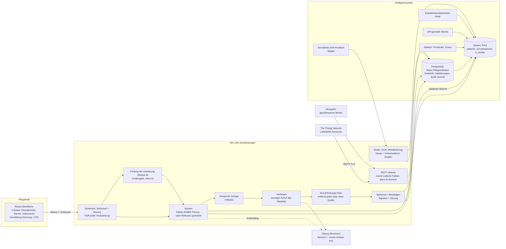
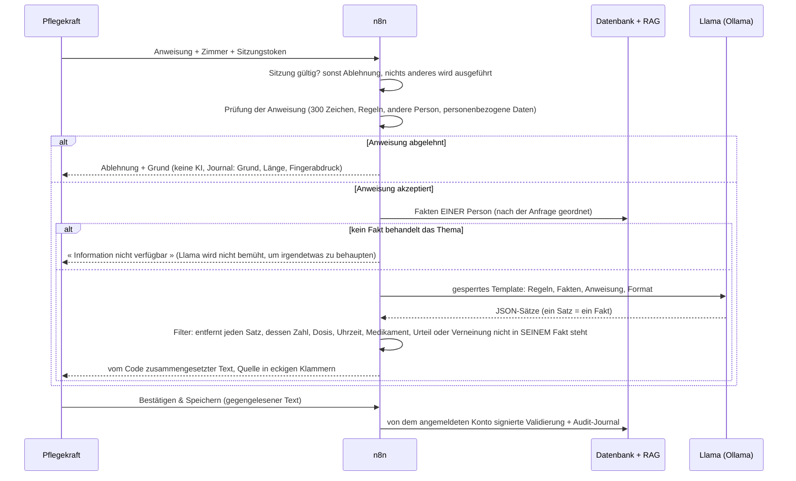

# Architektur

Alles läuft lokal auf einem Rechner (Docker). Die Daten sind fiktiv. Ollama (das Sprachmodell) ist auf dem Rechner installiert, außerhalb von Docker.

## Überblick

Die fünf Konnektoren (Pflegesoftware, FHIR, ePA, Dateien, KIM) speisen das RAG viermal täglich (00:00, 06:00, 12:00, 18:00, Berliner Zeit) über einen gemeinsamen Unter-Workflow (« Indexierer ») mit Duplikatsperre per Fingerabdruck. Die Pflegesoftware wird zusätzlich bei jeder Anfrage **live** gelesen, da das RAG sechs Stunden Verspätung haben kann.

## Der Weg einer Anfrage (Modus B)

## Was was garantiert

| Garantie | Wo sie eingehalten wird | Test |
|---|---|---|
| Der freie Text einer Pflegekraft erreicht die KI nur über die Prüfung, dann über den Block ANWEISUNG PFLEGEKRAFT | Graph der Workflows | `tests/chemins-ia.test.mjs` |
| Nur ein Aufruf der generativen KI im gesamten Repository | « Verfassen » | `tests/briques.test.mjs` |
| Kein Satz ohne Quelle in einem zusammengesetzten Text | Filter « Antwort prüfen » | `tests/anti-invention.test.mjs` |
| Kein Zugriff ohne Sitzung; Signatur wird der Sitzung entnommen | Knoten « Sitzung » jedes Eingangs | `tests/securite.test.mjs`, `tests/securite-live.mjs` |
| Die Widerspruchsregeln laufen vor jeder KI | « Nur Regeln » | `tests/taches.test.mjs`, `tests/regles.test.mjs` |
| Ein Alarm wird vor jedem KI-Schritt gespeichert | Workflow 81 | `tests/alarmes.test.mjs` |
| Zwei Bewohner werden nicht vermischt (Namensvettern Müller) | Identifizierung nach Name UND Geburtsdatum | `tests/batterie.mjs` |
| Ein validierter Bericht wird nicht als Fakt erneut gelesen | « Suchen » | `tests/apres-validation.test.mjs` |

## Die Dienste

| Dienst | Aufgabe | Port (Rechner) |
|---|---|---|
| n8n | alle Workflows | 5679 |
| PostgreSQL | fiktive Pflegesoftware (`soins`), Entwürfe, Validierungen, Sitzungen, Journal | — |
| Qdrant | RAG (768 Dimensionen, Cosine) | 6335 |
| Mosquitto | Sensoralarme (Konten `capteurs` und `n8n`) | 1884 |
| Mailpit | simuliertes KIM-Postfach, Übermittlung an das nächste Team | 8025 |
| OCR (OCRmyPDF) | gescannte Briefe | — |
| HAPI FHIR, ePA-Mocks | Krankenhausdatenbank, ePA (Start auf Abruf, speicherhungrig) | 8090, 8082–8085 |
| Ollama (Rechner) | `llama3.2`, `nomic-embed-text` | 11434 |

Details: [Schema des RAG](schema-rag.md), [KI-Bausteine](briques-ia.md), [Oberfläche und n8n-Vertrag](interface-n8n.md), [Alarme](alarmes.md), [Dokumente](documents.md), [Sicherheit](securite.md).
