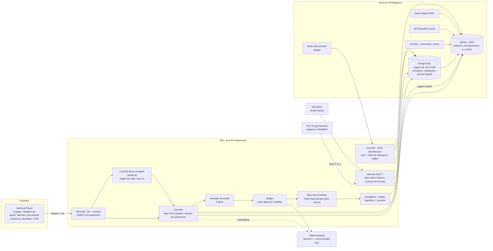
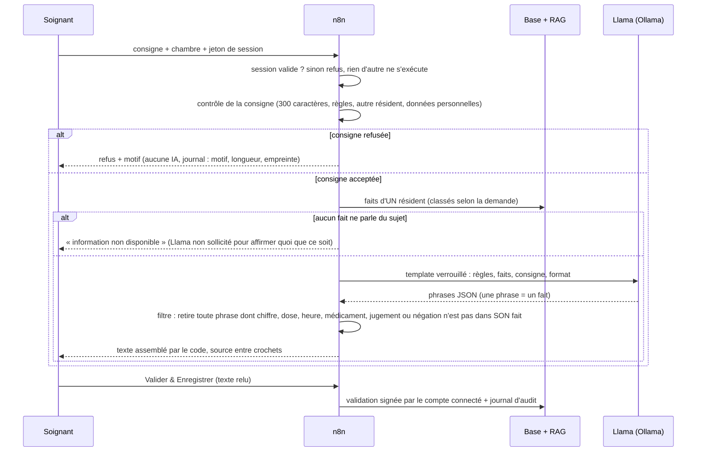

# Architecture

Tout tourne en local sur un poste (Docker). Les données sont fictives. Ollama (le modèle de langage) est installé sur le poste, hors Docker.

## Vue d'ensemble

Les cinq connecteurs (logiciel de soins, FHIR, ePA, fichiers, KIM) alimentent le RAG quatre fois par jour (00:00, 06:00, 12:00, 18:00, heure de Berlin) par un sous-workflow commun (« Indexeur ») avec anti-doublon par empreinte. Le logiciel de soins est en plus lu **en direct** à chaque demande, car le RAG peut avoir six heures de retard.

## Le chemin d'une demande (Mode B)

## Ce qui garantit quoi

| Garantie | Où elle est tenue | Test |
|---|---|---|
| Le texte libre d'un soignant n'atteint l'IA que par le contrôle, puis le bloc INSTRUCTION SOIGNANT | graphe des workflows | `tests/chemins-ia.test.mjs` |
| Un seul appel à l'IA générative dans tout le dépôt | « rédiger » | `tests/briques.test.mjs` |
| Aucune phrase sans source dans un texte assemblé | filtre « Contrôler la réponse » | `tests/anti-invention.test.mjs` |
| Aucun accès sans session ; signature prise dans la session | nœuds « Session » de chaque entrée | `tests/securite.test.mjs`, `tests/securite-live.mjs` |
| Les règles de contradiction passent avant toute IA | « Règles seules » | `tests/taches.test.mjs`, `tests/regles.test.mjs` |
| Une alarme est enregistrée avant toute étape d'IA | workflow 81 | `tests/alarmes.test.mjs` |
| Deux résidents ne se mélangent pas (homonymes Müller) | identification par nom ET date de naissance | `tests/batterie.mjs` |
| Un rapport validé n'est pas relu comme un fait | « chercher » | `tests/apres-validation.test.mjs` |

## Les services

| Service | Rôle | Port (poste) |
|---|---|---|
| n8n | tous les workflows | 5679 |
| PostgreSQL | logiciel de soins fictif (`soins`), brouillons, validations, sessions, journal | — |
| Qdrant | RAG (768 dimensions, Cosine) | 6335 |
| Mosquitto | alarmes de capteurs (comptes `capteurs` et `n8n`) | 1884 |
| Mailpit | boîte KIM simulée, transmission à l'équipe suivante | 8025 |
| OCR (OCRmyPDF) | lettres scannées | — |
| HAPI FHIR, mocks ePA | base de l'hôpital, ePA (démarrage à la demande, gourmands en mémoire) | 8090, 8082–8085 |
| Ollama (poste) | `llama3.2`, `nomic-embed-text` | 11434 |

Détails : [schéma du RAG](schema-rag.md), [briques IA](briques-ia.md), [interface et contrat n8n](interface-n8n.md), [alarmes](alarmes.md), [documents](documents.md), [sécurité](securite.md).
