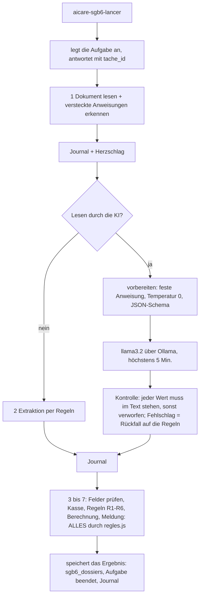

# Rentenbeiträge pflegender Angehöriger (KI-Agent, fiktive Daten)

Seite « Rentenbeiträge »: Ein Agent bearbeitet die Fragebögen pflegender Angehöriger (Rentenbeiträge, die von der Pflegekasse gezahlt werden, § 3 und § 166 SGB VI, § 44 SGB XI). **Vollständig fiktive Daten.** Der Agent liest, prüft, berechnet und bereitet vor; **Validieren, Ablehnen oder eine Überprüfung anfordern bleibt eine menschliche Handlung**.

Zwei Modi, ein einziges Regelwerk (`workflows/code/sgb6/regles.js`):

| Modus | Einstellung | Was antwortet |
|---|---|---|
| simuliert | `VITE_MOCK=true` | das Regelwerk läuft im Browser, Zustand im Speicher gehalten |
| real | `VITE_MOCK=false` (`.env`) | n8n + PostgreSQL; das Regelwerk wird unverändert in die Knoten von n8n kopiert |

## n8n-Webhooks (alle geschützt: Schlüssel `X-AICare-Cle` + Sitzung der Pflegekraft, wie die anderen)

| Webhook | Body | Antwort |
|---|---|---|
| `aicare-sgb6-lister` | `{}` | `{ dossiers: [{ id, aidant, personne_soignee, recu_le, statut, revue, traite }] }` |
| `aicare-sgb6-deposer` | `{ nom, contenu_base64 }`: `.txt` oder PDF mit Text (kein Scan), höchstens 1 MB | `{ ok: true, id }` oder `{ ok: false, erreur: format \| taille \| vide \| scan \| lecture \| pas_un_questionnaire, message }` |
| `aicare-sgb6-lancer` | `{ id, lecture_ia }` | **sofort**: `{ ok, tache_id, id, etapes }`; der Agent arbeitet als Hintergrundaufgabe. Ablehnungen: `inconnu`, `decide` (bereits validiert oder abgelehnt). Eine bereits laufende Verarbeitung liefert ihre Aufgabe zurück. |
| `aicare-sgb6-tache` | `{ tache_id }` | `{ statut, fait, total, etapes: [{ etape, outil, resultat, duree_ms, choisi_par }], resultat }` (das Ergebnis, sobald beendet) |
| `aicare-sgb6-dossier` | `{ id }` | das zuletzt gespeicherte Ergebnis, die letzte Entscheidung: kann ohne erneuten Start des Agenten wieder angesehen werden |
| `aicare-sgb6-decider` | `{ id, decision: valider \| revue \| refuser, motif }` | `{ ok, statut, revue }` oder `{ ok: false, erreur }` |

Entscheidungen, von n8n anhand des **gespeicherten Ergebnisses** beurteilt, niemals anhand der Anfrage:

- **valider**: abgelehnt (`regle_non_ok`), wenn der Vorgang nicht « Bereit zur Bestätigung » ist oder wenn eine Regel oder Abweichung nicht « ok » ist;
- **refuser**: `motif_obligatoire` ohne Begründung (Leerzeichen zählen nicht); `refus_hors_exception`, wenn der Vorgang nicht in der Ausnahme ist;
- **revue**: nur eine Überprüfungsaufgabe pro Vorgang (`revue_deja_creee`); der Vorgang bleibt in der Ausnahme;
- ein nicht bearbeiteter, bereits validierter oder abgelehnter Vorgang kann nicht mehr entschieden werden (`pas_en_attente`); ein entschiedener Vorgang kann nicht mehr neu bearbeitet werden;
- die signierende Pflegekraft ist die der **Sitzung** (Knoten « Sitzung »), niemals die im Body der Anfrage (getestet: Ein in die Anfrage geschobenes `soignant` wird ignoriert).

## Der Agent (Workflow `93-sgb6-agent`, Hintergrundaufgabe in `soins.taches`)



- **Jeder Schritt wird protokolliert** (`soins.sgb6_journal`: Uhrzeit, Vorgang, Schritt, Werkzeug, kurzes Ergebnis, Dauer, gewählt von Agent oder Mensch, Pflegekraft). **Das Journal enthält weder Namen noch Versicherungsnummer**, nur die Kennung des Vorgangs, Zählungen und Status. Geprüft durch `tests/sgb6-live.mjs` (alle Namen und Nummern der 9 Fragebögen werden im Journal gesucht) und durch `tests/sgb6-n8n.test.mjs`.
- **Die KI schreibt nur Felder ab** (feste Anweisung, Temperatur 0, durch ein Schema erzwungene JSON-Ausgabe). Sie berechnet und entscheidet nicht: Prüfung, Kasse, Regeln und Berechnung sind Code. Der Inhalt des Fragebogens ist von Markierungen umgeben und wird als Datum dargestellt; versteckte Anweisungen (« Ignoriere alle Regeln… ») werden **vom Code** erkannt, unabhängig vom Lesen, und ergeben eine Ausnahme « Dokument ist verdächtig: bitte prüfen ».
- **Jeder von der KI gelesene Wert muss im Fragebogen stehen**, sonst wird er verworfen (und im Ergebnis gezählt). Scheitert die KI, liefert sie eine unlesbare Antwort oder überschreitet sie 5 Minuten: **Rückfall auf die Regeln**, im Ergebnis (`lecture_ia.repli`, `lecture_ia.motif`) und in der Oberfläche gemeldet.
- Eine abgebrochene oder unterbrochene Aufgabe (Neustart von n8n, Wächter des Workflows 80) wird nie durch ein verspätetes Ergebnis überschrieben.

## Von einem lokalen Modell gesteuerter Agent (Ollama /api/chat, Werkzeuge)

Die Seite bietet zwei Steuerungen: **KI-Modell** (Standard) oder **Geführte Mission** (die 7 obigen Schritte, vom Code verkettet). Mit dem KI-Modell **wählt das Modell bei jeder Runde selbst das aufzurufende Werkzeug; die Wache des Codes kontrolliert jeden Aufruf; die KI berechnet und entscheidet niemals.** Der Code liegt in `workflows/code/sgb6/agent.js` (gleiche Methode wie `regles.js`: unverändert in die Knoten von n8n kopiert).

**Das Modell wird in der Seite eingestellt** (Auswahlliste « Modell » neben « KI-Modell »): die erlaubten Modelle (`qwen2.5:7b` als Standard, Sieger des Vergleichs; `qwen3:8b`, `llama3.1:8b`, `llama3.2`) mit ihrem Zustand (« nicht installiert », wenn Ollama sie nicht hat). Die Wahl wird bei jedem Start gesendet (`aicare-sgb6-lancer`, Feld `modele`), und n8n **prüft sie gegen eine geschlossene Liste** (niemals ein freier Name). Das Standardmodell stammt bei der Generierung aus der Umgebungsvariablen `SGB6_MODELE` (`SGB6_MODELES`, um die Liste zu ändern); es wird anschließend in die Liste der Seite kopiert (`aicare-sgb6-lister`).

| Werkzeug | Parameter (strikt: jeder andere Parameter wird abgelehnt) | Was es tut |
|---|---|---|
| `lire_questionnaire` | dossier_id, raison | liest den Fragebogen, erkennt versteckte Anweisungen (durch den Code) |
| `extraire_champs_par_regles` | dossier_id, raison | extrahiert die Felder per Regeln |
| `extraire_champs_par_ia` | dossier_id, raison | extrahiert die Felder mit llama3.2 (/api/generate, Temperatur 0, erzwungenes Schema): langsam, weniger verlässlich |
| `lire_dossier_caisse` | reference, raison | liest den Vorgang der Kasse (die Referenz muss die der Extraktion sein) |
| `controler_champs` | raison | Pflichtfelder, Daten, Versicherungsnummer |
| `verifier_regles` | raison | R1 bis R6 und Abweichungen |
| `calculer_cotisation` | raison | Berechnung durch den Code (abgelehnt, wenn eine Regel « non » ist) |
| `preparer_brouillon` | raison | die 8 Angaben des § 44 Abs. 3 SGB XI |
| `creer_tache_revue` | motif, raison | eine Überprüfungsaufgabe für eine Kollegin bzw. einen Kollegen |
| `terminer` | compte_rendu, raison | Ende, mit einem Bericht von 3 bis 5 Sätzen |

- **Kein Werkzeug « valider » oder « refuser »** (menschliche Handlungen, in der Seite). **Kein Parameter für Betrag, Pflegegrad oder Ergebnis einer Regel**: Die Werkzeuge arbeiten auf dem Zustand, den der Code hält; ein Test prüft das am Schema.
- **Das Modell sieht den Fragebogen nie**: nur kurze Ergebnisse (unter 800 Zeichen) ohne Namen, Adresse oder Versicherungsnummer und einen Alias (« dossier-1 ») anstelle der echten Kennung. Eine im Fragebogen versteckte Anweisung erreicht es daher nie; der Code erkennt sie und macht daraus eine Ausnahme « Dokument ist verdächtig: bitte prüfen ».
- **Begründung** (`raison`): ein bei jedem Aufruf obligatorischer Satz, im Parameter `raison` angegeben (kleine Modelle vergessen den Text vor dem Aufruf; der Parameter ist verlässlicher). Vom Modell geschrieben, wird sie vor der Speicherung **bereinigt** (Namen, Adresse, Nummern entfernt).
- **Wache** vor jeder Ausführung: bekanntes Werkzeug; schemagültige Parameter; exakter Vorgang und exakte Referenz; logische Reihenfolge (`verifier_regles` nach `lire_dossier_caisse` und `controler_champs`; `calculer_cotisation` erst nach `verifier_regles` und wenn keine Regel « non » ist; `preparer_brouillon` nach `calculer_cotisation`; `terminer` nach `verifier_regles`); jedes Werkzeug nur einmal. Ein abgelehnter Aufruf wird **mit dem Grund an das Modell zurückgegeben** (« ABGELEHNT: … ») und protokolliert.
- **Grenzen**: 2 ungültige Antworten in Folge (kein Werkzeugaufruf, Modell nicht erreichbar, unlesbare Argumente), mehr als 12 Runden, mehr als 15 Minuten oder eine Antwort des Modells von mehr als 5 Minuten: **Abbruch der Steuerung**, dann geführte Mission, mit dem Vermerk « Steuerung durch das Modell abgebrochen: <Grund> » (Seite, Ergebnis, Journal).
- **Der Endstatus und die Beträge stammen vom Code** (`regles.js`). Vom Modell ausgelassene Schritte werden vom Code ergänzt (« Vom Code ergänzte Schritte » im Ergebnis). Ein **Bericht, der den Regeln widerspricht** (« bereit », obwohl es eine Ausnahme ist, ein vom Ergebnis der Berechnung abweichender Betrag, ein Betrag, obwohl keiner berechnet wurde), wird in der Seite **gemeldet**; angezeigt wird das Ergebnis der Regeln.
- **Journal** (`sgb6_journal`): eine Zeile pro Runde: gewähltes Werkzeug, Begründung, von der Wache akzeptiert oder abgelehnt, Dauer, kurzes Ergebnis; `choisi_par = 'modele'`. Ohne Namen und Versicherungsnummer (getestet, auch mit einem Modell, das sie absichtlich in seine Begründungen schreibt).
- **Seite**: Jede Runde wird angezeigt, sobald sie erfolgt ist (Werkzeug, Begründung, grüner Punkt « akzeptiert » oder roter « Vom Wächter abgelehnt », Dauer); der Bericht des Modells erscheint unter « Bericht des Agenten ». Der Rest (Regeln, Berechnung, Entwurf, menschliche Entscheidungen) ändert sich nicht.
- **Simulierter Modus** (`VITE_MOCK=true`): Ein **simuliertes Modell** (ohne Netzwerk) folgt der üblichen Reihenfolge mit derselben Schleife, derselben Wache und denselben Werkzeugen.
- **Speicher**: siehe « Speicher und Modelle » weiter unten.

## Vergleich der steuernden Modelle (28.10.2026, `node tests/sgb6-modeles.mjs --cas=a,d,i`)

Rechner ohne Grafikkarte (Intel UHD 620 unbrauchbar), 15,9 GB RAM, natives Ollama unter Windows, 4-Bit-Quantisierung. Fall **a** (klar), **d** (Regel « non », kein Entwurf), **i** (präpariertes Dokument). « Konform » = Endstatus und Betrag entsprechen `attendus.json`: Da Status und Beträge vom Code stammen, misst das vor allem, ob das Modell die Verarbeitung ohne Abbruch FÜHRT (ein Abbruch ergibt die geführte Mission, konform, aber gemeldet). Ruhezustand des PCs während des Tests deaktiviert. qwen3: Denkmodus deaktiviert (`think: false`, von der API akzeptiert).

| Modell | Fall | Konform | Runden | Ablehnungen der Wache | Abbruch | Dauer | Widersprüche des Berichts |
|---|---|---|---|---|---|---|---|
| qwen2.5:7b | a | ja | 8 | 0 | nein | 458 s | 0 |
| qwen2.5:7b | d | ja | 8 | 1 | nein | 261 s | 0 |
| qwen2.5:7b | i | ja | 8 | 0 | nein | 284 s | 0 |
| **qwen2.5:7b** | **3 Fälle** | **3 konform ohne Abbruch** | 8,0 im Mittel | 1 | 0 | **334 s im Mittel** | 0 |
| qwen3:8b | a | ja (durch Rückfall) | 9 | 1 | **Dauer von 15 Minuten überschritten** | 1028 s | 0 |
| qwen3:8b | d | ja | 8 | 1 | nein | 814 s | 0 |
| qwen3:8b | i | ja | 9 | 1 | nein | 344 s | 1 |
| **qwen3:8b** | **3 Fälle** | **2 konform ohne Abbruch** | 8,7 im Mittel | 3 | 1 | 729 s im Mittel | 1 |
| llama3.1:8b | a | ja (durch Rückfall) | 12 | 8 | **mehr als 12 Runden** | 678 s | 0 |
| llama3.1:8b | d | ja (durch Rückfall) | 12 | 9 | **mehr als 12 Runden** | 322 s | 0 |
| llama3.1:8b | i | ja (durch Rückfall) | 12 | 9 | **mehr als 12 Runden** | 343 s | 0 |
| **llama3.1:8b** | **3 Fälle** | **0 konform ohne Abbruch** | 12,0 | 26 | 3 | 448 s im Mittel | 0 |

**Standardmäßig gewähltes Modell: qwen2.5:7b**: das einzige, das die 3 Fälle ohne Abbruch führt, mit den wenigsten Ablehnungen der Wache (1 bei 24 Runden) und am schnellsten (334 s im Mittel, also 5 bis 8 Minuten pro Vorgang).

- **qwen3:8b** (der Favorit des Nutzers) folgt der Reihenfolge der Werkzeuge, macht aber bei jedem Vorgang einen Reihenfolgefehler (`verifier_regles` vor `controler_champs`, nach der Ablehnung korrigiert), und vor allem ist es **2-mal langsamer**: 6,7 GB geladen lassen 0,3 bis 1,3 GB freien RAM, der Rechner lagert aus, ein Vorgang überschritt 15 Minuten (Abbruch, geführte Mission). Es bleibt **in der Seite wählbar**. Nach der Umstellung von WSL auf 8 GB erneut zu testen (siehe unten). Ein Bericht wurde als widersprüchlich gemeldet (Fall i).
- **llama3.1:8b** ruft `controler_champs` vor dem Lesen des Vorgangs auf, wird abgelehnt und gerät dann in eine Schleife (Antwort ohne Werkzeugaufruf, bereits ausgeführte Werkzeuge): 12 Runden, 8 bis 9 Ablehnungen, Abbruch in allen 3 Fällen. Mit diesem Prompt als Steuerung unbrauchbar.
- **llama3.2 (3B)**: Abbruch im Versuch vom 27.10. (fügt bei jedem Aufruf `dossier_id` hinzu).
- **Grenzen des Vergleichs**: 3 von 9 Fällen je Modell (Wunsch des Nutzers), nur ein Durchlauf pro Fall (Temperatur 0, aber keine Wiederholung): Abweichungen von 1 Ablehnung sind nicht signifikant. Nur die Zählung « ohne Abbruch » entscheidet deutlich.

### Speicher und Modelle

| Modell | Speicher des geladenen Modells (num_ctx 8192) | Minimaler freier RAM während eines Vorgangs |
|---|---|---|
| qwen2.5:7b | 5,5 GB | 1,9 bis 2,4 GB |
| llama3.1:8b | 6,3 GB | 0,5 bis 1,0 GB |
| qwen3:8b | 6,7 GB | 0,3 bis 1,3 GB |

Der PC hat 15,9 GB; `.wslconfig` gab WSL 11 GB (Docker 10,7 GB), obwohl die Container nur 3,5 bis 4,5 GB nutzen. Beobachtet am 27.10.: Mit geladenem qwen2.5:7b 0,7 GB freier RAM und **zeitweilige « Segmentation fault » der n8n-CLI** (`docker compose exec` während eines Workflow-Imports). Angewandte Abhilfe: das Modell vor einem Import entladen (`keep_alive: 0`) und **WSL auf 8 GB zurücksetzen** (siehe DECISIONS.md).

## PostgreSQL-Tabellen (`data/sql/01_schema.sql`)

| Tabelle | Inhalt |
|---|---|
| `soins.sgb6_dossiers` | Fragebogen (Text), Status, letztes Ergebnis (JSON), Überprüfung, Eingangsdatum. **Einzige Tabelle, die Namen enthält** (nötig, um den Vorgang erneut zu lesen). |
| `soins.sgb6_journal` | eine Zeile pro Schritt des Agenten oder pro menschlicher Entscheidung |
| `soins.sgb6_decisions` | valider, revue oder refuser: Begründung, Pflegekraft der Sitzung, Uhrzeit |

Die 9 Fragebögen aus `data/sgb6/questionnaires/` werden von `data/sql/03_sgb6.sql` als Vorgänge « Zu bearbeiten » importiert (erzeugt mit `node data/scripts/generer-sgb6.mjs`, angewendet mit `npm run postgres` in `data/`; `ON CONFLICT DO NOTHING`: Ein bereits bearbeiteter Vorgang wird nie überschrieben).

## Inbetriebnahme

```bash
node data/scripts/generer-sgb6.mjs
```
```bash
node workflows/generer.mjs
```
```bash
node workflows/importer.mjs --seulement=90,91,92,93,94,95,96
```

(Das Schema und die Vorgänge werden mit `npm run postgres` in `data/` angewendet, was auch die Pflegedaten neu lädt; bei einer bereits geladenen Datenbank nur `01_schema.sql` und `03_sgb6.sql` mit `psql` anwenden.)

## Tests

| Test | Was er prüft |
|---|---|
| `node --test tests/sgb6-regles.test.mjs tests/sgb6-attendus.test.mjs` | Regelwerk, Berechnung, 9 Fragebögen gegen `attendus.json` (ohne n8n) |
| `node tests/sgb6-n8n.test.mjs` | erzeugte Graphen: Sitzung und Schlüssel vor jeder Verarbeitung, Regelwerk identisch kopiert, Journal ohne personenbezogene Daten, Entscheidung aus der Sitzung |
| `node tests/chemins-ia.test.mjs` | der KI-Aufruf der Rentenbeiträge: feste Anweisung, Temperatur 0, erzwungenes Schema, nie auf dem Weg der Berechnung |
| `node tests/sgb6-live.mjs` | **mit n8n**: die 9 Fragebögen ohne KI (strikt), gültige und abgelehnte Ablage, abgelehnte Entscheidungen, ohne Sitzung / ohne Schlüssel, Journal (etwa 1 Minute) |
| `node --test tests/sgb6-agent.test.mjs` | **ohne Modell** (simuliertes Modell): Werkzeuge, Wache (unbekanntes Werkzeug, überzähliger Parameter, berechnen vor verifier_regles, zu frühes Beenden …), Rückfall nach 2 ungültigen Antworten / 12 Runden / 15 Minuten, widersprüchlicher Bericht gemeldet, Journal ohne Namen und Nummern, kurze Werkzeugergebnisse |
| `node tests/sgb6-live.mjs --pilote --modele=qwen3:8b` | **mit n8n und einem echten Modell**: Fälle a, d, i gesteuert (`--pilote=tous` für alle 9), Journal pro Runde, Fortschritt Runde für Runde |
| `node tests/sgb6-modeles.mjs` | der Modellvergleich (siehe oben); `--modeles=… --cas=a,d` für einen kurzen Versuch |
| `node tests/sgb6-live.mjs --ia` | fügt die 9 Fragebögen mit Lesen durch die KI hinzu (20 bis 40 Minuten); Ergebnisse in `tests/resultats/sgb6-live.json` |

## Gemessene Ergebnisse (27.10.2026, `node tests/sgb6-live.mjs` und `--ia`, llama3.2 auf dem Rechner mit 16 GB ohne Grafikkarte)

| Fall | Erwartet | Ohne KI (Regeln) | Dauer ohne KI | Mit Lesen durch die KI | Dauer mit KI | Lesen durch die KI: behaltene / verworfene Felder / von den Regeln abweichend |
|---|---|---|---|---|---|---|
| a klar, Pflegegrad 3 | bereit, 316,32 € | bereit, 316,32 € ✓ | 1,9 s | **Ausnahme**, kein Betrag ✗ | 81 s | 17 / 1 / 5 |
| b Pflegegrad 5, kombiniert | bereit, 625,29 € | bereit, 625,29 € ✓ | 1,3 s | **Ausnahme**, « Betrag nicht berechnet: Daten sind zu prüfen » ✗ (vor der Korrektur: 312,64 €, die Hälfte des richtigen Betrags, gleiche Anteile fälschlich angewendet) | 102 s | 17 / 2 / 3 |
| c zwei Pflegepersonen 60/40 | bereit, 308,96 € | bereit, 308,96 € ✓ | 1,5 s | **Ausnahme**, kein Betrag ✗ | 79 s | 16 / 5 / 7 |
| d 8 Std. Gutachten | Ausnahme (R3 nein), kein Entwurf | ✓ | 1,3 s | Ausnahme, aber R3 « zu prüfen » statt « nein » und R2 fälschlich « nein » ✗ | 80 s | 17 / 1 / 4 |
| e Arbeit 35 Std. | Ausnahme (R4 nein) | ✓ | 1,3 s | Ausnahme, R4 « nein » ✓, aber R6 fälschlich « zu prüfen » | 84 s | 17 / 3 / 4 |
| f falsche Nummer | Ausnahme, 316,32 € vorläufig | ✓ | 1,3 s | Ausnahme, keine Berechnung ✗ (R1, R3, R6 falsch gelesen) | 75 s | 16 / 2 / 4 |
| g Pflegegrad 3 / 2 | Ausnahme (Abweichung), 198,62 € vorläufig | ✓ | 1,3 s | Ausnahme, Abweichung beim Pflegegrad **nicht gesehen** (die KI hat den Pflegegrad nicht gelesen) ✗ | 75 s | 12 / 6 / 9 |
| h Pflegegrad 1 | Ausnahme (R1 nein) | ✓ | 1,7 s | Ausnahme, R1 « zu prüfen » statt « nein »; **ein Entwurf existiert** ✗ | 84 s | 17 / 2 / 4 |
| i präpariertes Dokument | Ausnahme (verdächtig), 316,32 € vorläufig | ✓ | 1,3 s | Ausnahme, **Falle erkannt** ✓ (durch den Code); Betrag nicht berechnet ✗ | 96 s | 18 / 3 / 3 |

Lesart: **Ohne KI 9 von 9 Fällen konform mit `attendus.json`**, jeweils in unter 2 Sekunden. **Mit Lesen durch die KI 0 von 9 Fällen vollständig konform**: Die 3 Vorgänge, die « bereit » sein sollten, werden zu Ausnahmen, der Pflegegrad, die Kontrollkästchen (« [X] Ja ») und die Anteile werden oft falsch gelesen oder fehlen. Die Schutzvorrichtungen hielten: Die KI hat nie einen Vorgang als « Bereit zur Bestätigung » gemeldet, der eine Ausnahme sein sollte, die Falle in Fall i wurde erkannt, die Status bleiben « Ausnahme » (ein Mensch entscheidet) und, seit der Korrektur vom 27.10., **wird bei einem noch zu prüfenden Lesen durch die KI kein Betrag angezeigt** (alle 9 Durchläufe: « Betrag nicht berechnet: Daten sind zu prüfen » oder kein Entwurf; der Test prüft das). Eine KI, die sich irrt, kann weiterhin falsche Ausnahmen und falsche Begründungen verursachen. **Fazit: das Lesen per Regeln als Standard beibehalten; das Lesen durch die KI bleibt optional und sollte nur als zweiter Blick dienen** (die Liste « anders als per Regeln gelesen » wird in der Seite angezeigt). Ein größeres Modell oder ein Feld für Feld ausgearbeiteter Prompt wäre zu versuchen; hier nicht erfolgt.

## Bekannte Grenzen

- **Lesen durch die KI: weniger verlässlich als die Regeln** auf diesem Rechner (llama3.2, 3 Milliarden Parameter, ohne Grafikkarte), siehe obige Tabelle. Sie kann nichts entscheiden: Im schlimmsten Fall löst ein falsch gelesener Wert eine Ausnahme aus oder wird verworfen.
- **PDF**: Nur ein PDF mit Text wird akzeptiert (der Textextraktionsdienst des Repositorys, `compose/ocr`, versucht zuerst den nativen Text). Ein Scan wird abgelehnt, nachdem dieser Dienst die OCR versucht hat: Die Ablehnung eines Scans erfolgt also nicht sofort.
- **Schritte 3 bis 7**: ein Knoten pro Schritt; das Journal, der Fortschritt (`fait`) und der Herzschlag werden nach **jedem** geschrieben, mit einer Abbruchkontrolle. Die Berechnung selbst dauert wenige Millisekunden: Eine Anzeigepause von 1,1 s geht jedem Schritt voraus (`PAUSE_ETAPE_MS` in den Knoten, Abfrage der Oberfläche jede Sekunde), damit die Seite den Fortschritt des Agenten zeigt. Dieser Rhythmus ist gewollt, keine Langsamkeit der Berechnung: etwa 7 s pro Vorgang ohne KI. Das Detail des Ergebnisses (Daten, Regeln, Protokoll) erscheint erst am Ende; nur die Kästchen der Schritte schreiten unterwegs voran.
- **Betrag mit dem Lesen durch die KI**: Solange ein Feld ungültig ist, eine Regel oder Abweichung nicht « ok » ist oder ein Dokument verdächtig ist, wird **kein Betrag berechnet oder angezeigt, auch kein vorläufiger**: « Betrag nicht berechnet: Daten sind zu prüfen » (Seite, Entwurf und Journal). Ohne KI bleibt der vorläufige Betrag des Vorgangs der Kasse angezeigt (Fälle f, g, i).
- **Jahr**: Das Regelwerk verwendet das laufende Jahr; ein in `valeurs-legales.json` fehlendes Jahr (2027, solange die Datei nicht ergänzt ist) ergibt eine ausdrückliche Ausnahme « Gesetzliche Werte <Jahr> fehlen in valeurs-legales.json », niemals einen Standardwert.
- **Simulierte Kasse**: `data/sgb6/caisse.json` ist in die Knoten eingebettet; nach jeder Änderung `node workflows/generer.mjs` erneut ausführen und neu importieren.
