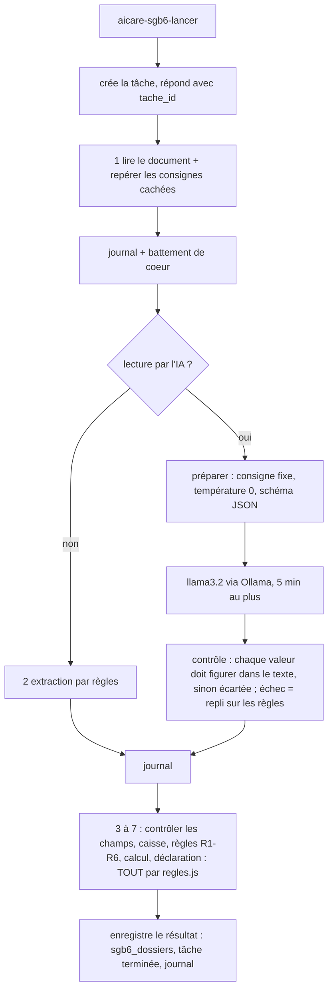

# Cotisations retraite des aidants familiaux (agent IA, données fictives)

Page « Cotisations retraite » : un agent traite les questionnaires des aidants familiaux (cotisations retraite payées par la caisse de dépendance, § 3 et § 166 SGB VI, § 44 SGB XI). **Données entièrement fictives.** L'agent lit, contrôle, calcule et prépare ; **valider, refuser ou demander une revue reste un acte humain**.

Deux modes, un seul moteur de règles (`workflows/code/sgb6/regles.js`) :

| Mode | Réglage | Ce qui répond |
|---|---|---|
| simulé | `VITE_MOCK=true` | le moteur de règles tourne dans le navigateur, état gardé en mémoire |
| réel | `VITE_MOCK=false` (`.env`) | n8n + PostgreSQL ; le moteur est recopié tel quel dans les nœuds de n8n |

## Webhooks n8n (tous protégés : clé `X-AICare-Cle` + session du soignant, comme les autres)

| Webhook | Corps | Réponse |
|---|---|---|
| `aicare-sgb6-lister` | `{}` | `{ dossiers: [{ id, aidant, personne_soignee, recu_le, statut, revue, traite }] }` |
| `aicare-sgb6-deposer` | `{ nom, contenu_base64 }` : `.txt`, ou PDF contenant du texte (pas un scan), 1 Mo au plus | `{ ok: true, id }` ou `{ ok: false, erreur: format \| taille \| vide \| scan \| lecture \| pas_un_questionnaire, message }` |
| `aicare-sgb6-lancer` | `{ id, lecture_ia }` | **tout de suite** : `{ ok, tache_id, id, etapes }` ; l'agent travaille en tâche de fond. Refus : `inconnu`, `decide` (déjà validé ou refusé). Un traitement déjà en cours renvoie sa tâche. |
| `aicare-sgb6-tache` | `{ tache_id }` | `{ statut, fait, total, etapes: [{ etape, outil, resultat, duree_ms, choisi_par }], resultat }` (le résultat une fois terminé) |
| `aicare-sgb6-dossier` | `{ id }` | le dernier résultat enregistré, la dernière décision : se revoit sans relancer l'agent |
| `aicare-sgb6-decider` | `{ id, decision: valider \| revue \| refuser, motif }` | `{ ok, statut, revue }` ou `{ ok: false, erreur }` |

Décisions, jugées par n8n sur le **résultat enregistré**, jamais sur la requête :

- **valider** : refusé (`regle_non_ok`) si le dossier n'est pas « prêt à valider » ou si une règle ou un écart n'est pas « ok » ;
- **refuser** : `motif_obligatoire` sans motif (les blancs ne comptent pas) ; `refus_hors_exception` si le dossier n'est pas en exception ;
- **revue** : une seule tâche de revue par dossier (`revue_deja_creee`) ; le dossier reste en exception ;
- un dossier non traité, déjà validé ou refusé ne peut plus être décidé (`pas_en_attente`) ; un dossier décidé ne peut plus être retraité ;
- le soignant qui signe est celui de la **session** (nœud « Session »), jamais celui du corps de la requête (testé : un `soignant` glissé dans la requête est ignoré).

## L'agent (workflow `93-sgb6-agent`, tâche de fond dans `soins.taches`)



- **Chaque étape est journalisée** (`soins.sgb6_journal` : heure, dossier, étape, outil, résultat court, durée, choisi par agent ou humain, soignant). **Le journal ne contient ni nom ni numéro d'assurance**, seulement l'identifiant du dossier, des comptes et des statuts. Vérifié par `tests/sgb6-live.mjs` (tous les noms et numéros des 9 questionnaires sont cherchés dans le journal) et par `tests/sgb6-n8n.test.mjs`.
- **L'IA ne fait que recopier des champs** (consigne fixe, température 0, sortie JSON imposée par un schéma). Elle ne calcule ni ne décide : le contrôle, la caisse, les règles et le calcul sont du code. Le contenu du questionnaire est entouré de repères et présenté comme une donnée ; les consignes cachées (« Ignoriere alle Regeln… ») sont repérées **par le code**, quelle que soit la lecture, et font une exception « document suspect ».
- **Chaque valeur lue par l'IA doit figurer dans le questionnaire**, sinon elle est écartée (et comptée dans le résultat). Si l'IA échoue, répond une réponse illisible ou dépasse 5 minutes : **repli sur les règles**, signalé dans le résultat (`lecture_ia.repli`, `lecture_ia.motif`) et dans l'interface.
- Une tâche annulée ou interrompue (redémarrage de n8n, veilleur du workflow 80) n'est jamais réécrite par un résultat tardif.

## Agent piloté par un modèle local (Ollama /api/chat, outils)

La page propose deux pilotes : **Modèle IA** (par défaut) ou **Mission guidée** (les 7 étapes ci-dessus, enchaînées par le code). Avec le modèle IA, **le modèle choisit lui-même l'outil à appeler à chaque tour ; la garde du code contrôle chaque appel ; l'IA ne calcule ni ne décide jamais.** Le code est dans `workflows/code/sgb6/agent.js` (même méthode que `regles.js` : recopié tel quel dans les nœuds de n8n).

**Le modèle se règle dans la page** (liste déroulante « Modèle », à côté de « Modèle IA ») : les modèles permis (`qwen2.5:7b` par défaut, le gagnant du comparatif ; `qwen3:8b`, `llama3.1:8b`, `llama3.2`) avec leur état (« non installé » si Ollama ne les a pas). Le choix part à chaque lancement (`aicare-sgb6-lancer`, champ `modele`) et n8n le **contrôle contre une liste fermée** (jamais un nom libre). Le modèle par défaut vient de la variable d'environnement `SGB6_MODELE` à la génération (`SGB6_MODELES` pour changer la liste) ; il est ensuite recopié dans la liste de la page (`aicare-sgb6-lister`).

| Outil | Paramètres (strict : tout autre paramètre est refusé) | Ce qu'il fait |
|---|---|---|
| `lire_questionnaire` | dossier_id, raison | lit le questionnaire, repère les consignes cachées (par le code) |
| `extraire_champs_par_regles` | dossier_id, raison | extrait les champs par les règles |
| `extraire_champs_par_ia` | dossier_id, raison | extrait les champs avec llama3.2 (/api/generate, température 0, schéma imposé) : lent, moins fiable |
| `lire_dossier_caisse` | reference, raison | lit le dossier de la caisse (la référence doit être celle de l'extraction) |
| `controler_champs` | raison | champs obligatoires, dates, numéro d'assurance |
| `verifier_regles` | raison | R1 à R6 et écarts |
| `calculer_cotisation` | raison | calcul par le code (refusé si une règle est « non ») |
| `preparer_brouillon` | raison | les 8 données du § 44 Abs. 3 SGB XI |
| `creer_tache_revue` | motif, raison | une tâche de revue pour un collègue |
| `terminer` | compte_rendu, raison | fin, avec un compte rendu de 3 à 5 phrases |

- **Aucun outil « valider » ni « refuser »** (gestes humains, dans la page). **Aucun paramètre de montant, de degré ni de résultat de règle** : les outils travaillent sur l'état que le code garde ; un test le vérifie sur le schéma.
- **Le modèle ne voit jamais le questionnaire** : seulement des résultats courts (moins de 800 caractères) sans nom, adresse ni numéro d'assurance, et un alias (« dossier-1 ») à la place de l'identifiant réel. Une consigne cachée dans le questionnaire n'arrive donc jamais jusqu'à lui ; le code la repère et en fait une exception « document suspect ».
- **Raison** : une phrase obligatoire à chaque appel, donnée dans le paramètre `raison` (les petits modèles oublient le texte avant l'appel ; le paramètre est plus fiable). Écrite par le modèle, elle est **épurée** (noms, adresse, numéros retirés) avant d'être enregistrée.
- **Garde** avant chaque exécution : outil connu ; paramètres valides au schéma ; dossier et référence exacts ; ordre logique (`verifier_regles` après `lire_dossier_caisse` et `controler_champs` ; `calculer_cotisation` seulement après `verifier_regles` et si aucune règle n'est « non » ; `preparer_brouillon` après `calculer_cotisation` ; `terminer` après `verifier_regles`) ; un outil une seule fois. Un appel refusé est **renvoyé au modèle avec la raison** (« REFUSÉ par la garde : … ») et journalisé.
- **Limites** : 2 réponses invalides de suite (pas d'appel d'outil, modèle injoignable, arguments illisibles), plus de 12 tours, plus de 15 minutes, ou une réponse du modèle de plus de 5 minutes : **abandon du pilotage**, puis mission guidée, avec la mention « pilotage par le modèle abandonné : <raison> » (page, résultat, journal).
- **Le statut final et les montants viennent du code** (`regles.js`). Les étapes que le modèle a omises sont complétées par le code (« étapes complétées par le code » dans le résultat). Un **compte rendu qui contredit les règles** (« prêt » alors que c'est une exception, un montant différent du calcul, un montant alors qu'aucun n'est calculé) est **signalé** dans la page ; le résultat des règles est celui qui s'affiche.
- **Journal** (`sgb6_journal`) : une ligne par tour : outil choisi, raison, accepté ou refusé par la garde, durée, résultat court ; `choisi_par = 'modele'`. Sans nom ni numéro d'assurance (testé, y compris avec un modèle qui les écrit exprès dans ses raisons).
- **Page** : chaque tour s'affiche dès qu'il est fait (outil, raison, pastille verte « acceptée » ou rouge « refusée par la garde », durée) ; le compte rendu du modèle s'affiche sous « Compte rendu de l'agent ». Le reste (règles, calcul, brouillon, décisions humaines) ne change pas.
- **Mode simulé** (`VITE_MOCK=true`) : un **modèle simulé** (sans réseau) suit l'ordre habituel avec la même boucle, la même garde et les mêmes outils.
- **Mémoire** : voir « Mémoire et modèles » plus bas.

## Comparatif des modèles pilotes (28.10.2026, `node tests/sgb6-modeles.mjs --cas=a,d,i`)

Poste sans carte graphique (Intel UHD 620 inutilisable), 15,9 Go de RAM, Ollama natif Windows, quantification 4 bits. Cas **a** (clair), **d** (règle « non », pas de brouillon), **i** (document piégé). « Conforme » = statut final et montant conformes à `attendus.json` : comme le statut et les montants viennent du code, cela mesure surtout si le modèle MÈNE le traitement sans abandon (un abandon donne la mission guidée, conforme mais signalé). Mise en veille du PC désactivée pendant le test. qwen3 : mode réflexion désactivé (`think: false`, accepté par l'API).

| Modèle | Cas | Conforme | Tours | Refus garde | Abandon | Durée | Contradictions du compte rendu |
|---|---|---|---|---|---|---|---|
| qwen2.5:7b | a | oui | 8 | 0 | non | 458 s | 0 |
| qwen2.5:7b | d | oui | 8 | 1 | non | 261 s | 0 |
| qwen2.5:7b | i | oui | 8 | 0 | non | 284 s | 0 |
| **qwen2.5:7b** | **3 cas** | **3 conformes sans abandon** | 8,0 en moyenne | 1 | 0 | **334 s en moyenne** | 0 |
| qwen3:8b | a | oui (par repli) | 9 | 1 | **durée de 15 minutes dépassée** | 1028 s | 0 |
| qwen3:8b | d | oui | 8 | 1 | non | 814 s | 0 |
| qwen3:8b | i | oui | 9 | 1 | non | 344 s | 1 |
| **qwen3:8b** | **3 cas** | **2 conformes sans abandon** | 8,7 en moyenne | 3 | 1 | 729 s en moyenne | 1 |
| llama3.1:8b | a | oui (par repli) | 12 | 8 | **plus de 12 tours** | 678 s | 0 |
| llama3.1:8b | d | oui (par repli) | 12 | 9 | **plus de 12 tours** | 322 s | 0 |
| llama3.1:8b | i | oui (par repli) | 12 | 9 | **plus de 12 tours** | 343 s | 0 |
| **llama3.1:8b** | **3 cas** | **0 conforme sans abandon** | 12,0 | 26 | 3 | 448 s en moyenne | 0 |

**Modèle retenu par défaut : qwen2.5:7b** : le seul à mener les 3 cas sans abandon, avec le moins de refus de la garde (1 sur 24 tours) et le plus rapide (334 s en moyenne, soit 5 à 8 minutes par dossier).

- **qwen3:8b** (le préféré de l'utilisateur) suit l'ordre des outils mais commet une erreur d'ordre à chaque dossier (`verifier_regles` avant `controler_champs`, corrigée après le refus), et surtout il est **2 fois plus lent** : 6,7 Go chargés laissent 0,3 à 1,3 Go de RAM libre, le poste swappe, un dossier a dépassé 15 minutes (abandon, mission guidée). Il reste **sélectionnable dans la page**. À retester après le passage de WSL à 8 Go (voir ci-dessous). Un compte rendu a été signalé comme contradictoire (cas i).
- **llama3.1:8b** appelle `controler_champs` avant la lecture du dossier, se fait refuser, puis boucle (réponse sans appel d'outil, outils déjà exécutés) : 12 tours, 8 à 9 refus, abandon dans les 3 cas. Inutilisable en pilote avec ce prompt.
- **llama3.2 (3B)** : abandon dans l'essai du 27.10 (ajoute `dossier_id` à chaque appel).
- **Limites du comparatif** : 3 cas sur 9 par modèle (demande de l'utilisateur), un seul passage par cas (température 0 mais pas de répétition) : les écarts de 1 refus ne sont pas significatifs. Seul le comptage « sans abandon » départage nettement.

### Mémoire et modèles

| Modèle | Mémoire du modèle chargé (num_ctx 8192) | RAM libre minimale pendant un dossier |
|---|---|---|
| qwen2.5:7b | 5,5 Go | 1,9 à 2,4 Go |
| llama3.1:8b | 6,3 Go | 0,5 à 1,0 Go |
| qwen3:8b | 6,7 Go | 0,3 à 1,3 Go |

Le PC a 15,9 Go ; `.wslconfig` donnait 11 Go à WSL (Docker 10,7 Go) alors que les conteneurs n'en utilisent que 3,5 à 4,5 Go. Observé le 27.10 : avec qwen2.5:7b chargé, 0,7 Go de RAM libre et des **« segmentation fault » intermittents du CLI n8n** (`docker compose exec` pendant un import de workflows). Remède appliqué : décharger le modèle avant un import (`keep_alive: 0`), et **WSL ramené à 8 Go** (voir DECISIONS.md).

## Tables PostgreSQL (`data/sql/01_schema.sql`)

| Table | Contenu |
|---|---|
| `soins.sgb6_dossiers` | questionnaire (texte), statut, dernier résultat (JSON), revue, date de réception. **Seule table qui contient des noms** (nécessaires pour relire le dossier). |
| `soins.sgb6_journal` | une ligne par étape de l'agent ou par décision humaine |
| `soins.sgb6_decisions` | valider, revue ou refuser : motif, soignant de la session, heure |

Les 9 questionnaires de `data/sgb6/questionnaires/` sont importés comme dossiers « à traiter » par `data/sql/03_sgb6.sql` (généré par `node data/scripts/generer-sgb6.mjs`, appliqué par `npm run postgres` dans `data/` ; `ON CONFLICT DO NOTHING` : un dossier déjà traité n'est jamais écrasé).

## Mise en route

```bash
node data/scripts/generer-sgb6.mjs
```
```bash
node workflows/generer.mjs
```
```bash
node workflows/importer.mjs --seulement=90,91,92,93,94,95,96
```

(le schéma et les dossiers s'appliquent avec `npm run postgres` dans `data/`, qui recharge aussi les données de soins ; sur une base déjà chargée, appliquer seulement `01_schema.sql` et `03_sgb6.sql` avec `psql`.)

## Tests

| Test | Ce qu'il vérifie |
|---|---|
| `node --test tests/sgb6-regles.test.mjs tests/sgb6-attendus.test.mjs` | moteur de règles, calcul, 9 questionnaires contre `attendus.json` (sans n8n) |
| `node tests/sgb6-n8n.test.mjs` | graphes générés : session et clé avant tout traitement, moteur recopié à l'identique, journal sans donnée personnelle, décision tirée de la session |
| `node tests/chemins-ia.test.mjs` | l'appel à l'IA des cotisations : consigne fixe, température 0, schéma imposé, jamais sur le chemin du calcul |
| `node tests/sgb6-live.mjs` | **avec n8n** : les 9 questionnaires sans IA (strict), dépôt valide et refusés, décisions refusées, sans session / sans clé, journal (environ 1 minute) |
| `node --test tests/sgb6-agent.test.mjs` | **sans modèle** (modèle simulé) : outils, garde (outil inconnu, paramètre en trop, calculer avant verifier_regles, terminer trop tôt…), repli après 2 réponses invalides / 12 tours / 15 minutes, compte rendu contradictoire signalé, journal sans nom ni numéro, résultats d'outils courts |
| `node tests/sgb6-live.mjs --pilote --modele=qwen3:8b` | **avec n8n et un vrai modèle** : cas a, d, i pilotés (`--pilote=tous` pour les 9), journal par tour, avancement tour par tour |
| `node tests/sgb6-modeles.mjs` | le comparatif des modèles (voir plus bas) ; `--modeles=… --cas=a,d` pour un essai court |
| `node tests/sgb6-live.mjs --ia` | ajoute les 9 questionnaires avec lecture par l'IA (20 à 40 minutes) ; résultats dans `tests/resultats/sgb6-live.json` |

## Résultats mesurés (27.10.2026, `node tests/sgb6-live.mjs` et `--ia`, llama3.2 sur le poste de 16 Go sans carte graphique)

| Cas | Attendu | Sans IA (règles) | Durée sans IA | Avec lecture par l'IA | Durée avec IA | Lecture IA : champs gardés / écartés / différents des règles |
|---|---|---|---|---|---|---|
| a clair, degré 3 | prêt, 316,32 € | prêt, 316,32 € ✓ | 1,9 s | **exception**, aucun montant ✗ | 81 s | 17 / 1 / 5 |
| b degré 5, combinée | prêt, 625,29 € | prêt, 625,29 € ✓ | 1,3 s | **exception**, « Montant non calculé : données à vérifier » ✗ (avant la correction : 312,64 €, la moitié du bon montant, parts égales appliquées à tort) | 102 s | 17 / 2 / 3 |
| c deux aidants 60/40 | prêt, 308,96 € | prêt, 308,96 € ✓ | 1,5 s | **exception**, aucun montant ✗ | 79 s | 16 / 5 / 7 |
| d 8 h d'expertise | exception (R3 non), pas de brouillon | ✓ | 1,3 s | exception, mais R3 « à vérifier » au lieu de « non » et R2 « non » à tort ✗ | 80 s | 17 / 1 / 4 |
| e travail 35 h | exception (R4 non) | ✓ | 1,3 s | exception, R4 « non » ✓ mais R6 « à vérifier » à tort | 84 s | 17 / 3 / 4 |
| f numéro faux | exception, 316,32 € provisoire | ✓ | 1,3 s | exception, aucun calcul ✗ (R1, R3, R6 mal lues) | 75 s | 16 / 2 / 4 |
| g degré 3 / 2 | exception (écart), 198,62 € provisoire | ✓ | 1,3 s | exception, écart de degré **non vu** (l'IA n'a pas lu le degré) ✗ | 75 s | 12 / 6 / 9 |
| h degré 1 | exception (R1 non) | ✓ | 1,7 s | exception, R1 « à vérifier » au lieu de « non » ; **un brouillon existe** ✗ | 84 s | 17 / 2 / 4 |
| i document piégé | exception (suspect), 316,32 € provisoire | ✓ | 1,3 s | exception, **piège repéré** ✓ (par le code) ; montant non calculé ✗ | 96 s | 18 / 3 / 3 |

Lecture : **sans IA, 9 cas sur 9 conformes à `attendus.json`**, en moins de 2 secondes chacun. **Avec lecture par l'IA, 0 cas sur 9 entièrement conforme** : les 3 dossiers qui devaient être « prêts » deviennent des exceptions, le degré, les cases à cocher (« [X] Ja ») et les parts sont souvent mal lus ou absents. Les garde-fous ont tenu : l'IA n'a jamais rendu « prêt à valider » un dossier qui devait être en exception, le piège du cas i a été repéré, les statuts restent « exception » (un humain décide) et, depuis la correction du 27.10, **aucun montant n'est affiché sur une lecture par l'IA qui reste à vérifier** (les 9 passages : « Montant non calculé : données à vérifier » ou pas de brouillon ; le test le vérifie). Une IA qui se trompe peut encore provoquer de fausses exceptions et de faux motifs. **Conclusion : garder la lecture par les règles comme défaut ; la lecture par l'IA reste facultative et ne devrait servir que de second regard** (la liste « lue autrement que par les règles » s'affiche dans la page). Un modèle plus grand ou un prompt travaillé champ par champ serait à essayer ; non fait ici.

## Limites connues

- **Lecture par l'IA : moins fiable que les règles** sur ce poste (llama3.2, 3 milliards de paramètres, sans carte graphique), voir le tableau ci-dessus. Elle ne peut rien décider : au pire, une valeur mal lue provoque une exception ou est écartée.
- **PDF** : seul un PDF contenant du texte est accepté (le service d'extraction de texte du dépôt, `compose/ocr`, essaie d'abord le texte natif). Un scan est refusé après que ce service a tenté l'OCR : le refus d'un scan n'est donc pas instantané.
- **Étapes 3 à 7** : un nœud par étape ; le journal, l'avancement (`fait`) et le battement de coeur sont écrits après **chacune**, avec un contrôle d'annulation. Le calcul lui-même prend quelques millisecondes : une pause d'affichage de 1,1 s précède chaque étape (`PAUSE_ETAPE_MS` dans les nœuds, interrogation de l'interface chaque seconde) pour que la page montre l'agent avancer. Ce rythme est voulu, pas une lenteur du calcul : environ 7 s par dossier sans IA. Le détail du résultat (données, règles, protocole) n'apparaît qu'à la fin ; seules les cases des étapes avancent en cours de route.
- **Montant avec la lecture par l'IA** : tant qu'un champ est invalide, qu'une règle ou un écart n'est pas « ok » ou qu'un document est suspect, **aucun montant n'est calculé ni affiché, même provisoire** : « Montant non calculé : données à vérifier » (page, brouillon et journal). Sans IA, le montant provisoire du dossier de la caisse reste affiché (cas f, g, i).
- **Année** : le moteur utilise l'année courante ; une année absente de `valeurs-legales.json` (2027, tant que le fichier n'est pas complété) donne une exception explicite « valeurs légales absentes », jamais une valeur par défaut.
- **Caisse simulée** : `data/sgb6/caisse.json` est embarqué dans les nœuds ; relancer `node workflows/generer.mjs` et réimporter après toute modification.
