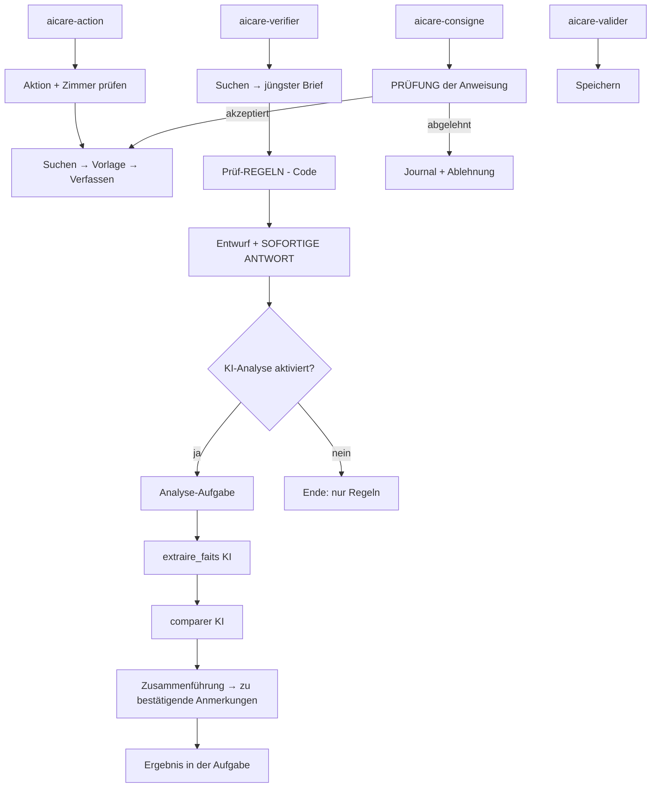

# Mit n8n verbundene Oberfläche

Die Oberfläche vom simulierten in den realen Modus umschalten: `VITE_MOCK=false` in die Datei `.env` im Stammverzeichnis setzen und dann `npm run dev` in `front/` neu starten. Alles läuft über `front/src/api.js`; keine andere Datei der Oberfläche ändert sich je nach Modus.

## Drei Einstiegspunkte (n8n-Webhooks)

| Webhook | Aufgerufen von | Body der Anfrage | Antwort |
|---|---|---|---|
| `POST /webhook/aicare-action` | den 4 Schaltflächen des Modus A | `{ "action": "rapport_garde", "chambre": "12" }` | ein Entwurf (siehe unten) |
| `POST /webhook/aicare-consigne` | Modus B | `{ "chambre": "12", "consigne": "…" }` (höchstens 300 Zeichen) | ein Entwurf **oder** eine Ablehnung |
| `POST /webhook/aicare-valider` | der Schaltfläche « Bestätigen & Speichern » | `{ "brouillon_id": "…", "texte": "…" }` | `{ "ok": true, … }` oder `{ "ok": false, "erreur": "…" }` |

Aktionen des Modus A: `rapport_garde` (SBAR), `resume_epa`, `points_vigilance`, `verifier_document`. Die Aktion wählt einen **verborgenen Prompt** (`prompts/*.md`); die Oberfläche liefert keinen Text und wählt weder den Zeitraum noch die Suchwörter.

### Antwort « Entwurf »

```json
{
  "brouillon_id": "b546682d-…",
  "texte": "S – Situation : …",
  "sources": ["Logiciel de soins", "ePA"],
  "alertes": [{ "type": "contradiction", "message": "…" }],
  "avertissements": [{ "type": "phrase_sans_source", "detail": "…" }]
}
```

- `alertes`: roter Balken (Widersprüche zwischen Dokumenten; Sensoralarme, sobald MQTT angebunden ist).
- `avertissements`: « Vor der Bestätigung prüfen », automatische Kontrollen des Textes (siehe `docs/briques-ia.md`).
- `brouillon_id`: `null`, wenn nichts zu speichern ist (z. B. kein zu prüfender Brief); die Validierungsschaltfläche verschwindet.
- Der Text ist ein **Entwurf**: Vor der Validierung wird nichts gespeichert.

### Antwort « Ablehnung » (Modus B)

```json
{ "refuse": true, "motif": "regles", "message": "Die Anweisung versucht, die Regeln des Assistenten zu ändern: Sie wird abgelehnt." }
```

Gründe: `longueur`, `format`, `regles`, `mots_interdits`, `autre_resident`. **Es wurde nichts an die KI gesendet.** Das Journal behält den Grund, die Länge und den SHA-256-Fingerabdruck der Anweisung, niemals ihren Text.

## Was jeder Einstiegspunkt tut



### « Dokument prüfen »: Die Regeln antworten sofort, die KI folgt als Hintergrundaufgabe

| Webhook | Body | Antwort |
|---|---|---|
| `POST /webhook/aicare-verifier` | `{ "chambre": "12" }` | **sofort**: ein Entwurf mit dem Bericht der Regeln, den Warnungen und `analyse: { statut, tache_id }` |
| `POST /webhook/aicare-tache` | `{ "tache_id": "…" }` | `{ statut, resultat: { remarques, alertes, avertissements, indisponible } }` |
| `POST /webhook/aicare-reglage` | `{}` zum Lesen, `{ "valeur": false }` zum Abschalten der KI | `{ cle: "verification_ia", valeur: true \| false }` |

1. Der jüngste wartende Brief der Collection `a_verifier` wird für die Person gefunden (ohne Brief: Antwort ohne Entwurf, keine KI).
2. **Regelnetz** (Code, ohne KI), angewendet auf den Text des Briefs und die Fakten der Akte **vor jeder Antwort**:

| Regel | Auslöser |
|---|---|
| `allergie` | ein Medikament des Briefs gehört zu einer Familie, für die eine Allergie bekannt ist (Penicilline, Sulfonamide) |
| `anticoagulation_double` | ein Antikoagulans im Brief, obwohl die Person bereits ein anderes einnimmt, ohne dass das Absetzen des ersten erwähnt wird |
| `insuffisance_renale` | ein Entzündungshemmer (NSAR), obwohl die Akte oder der Brief eine Niereninsuffizienz angibt |

3. **Sofortige Antwort**: Der Bericht wird vom Code verfasst, jede Zeile nennt ihre Quellen in eckigen Klammern, ein Entwurf wird angelegt, damit er validiert werden kann. Der rote Balken wird sofort angezeigt.
4. **Ergänzende Analyse (KI, als Hintergrundaufgabe)**, wenn die Einstellung `verification_ia` aktiviert ist: Extraktion (`extraire_faits`), dann Vergleich (`comparer`). Schlägt ein Schritt fehl, läuft der nächste weiter; schlagen beide fehl, endet die Aufgabe mit `termine_avec_erreurs`, und die Oberfläche meldet, dass die Analyse nicht verfügbar ist. Die Regeln ändern sich nie.
5. **Zusammenführung**: Was die KI hinzufügt, ist eine **Anmerkung « zu bestätigen »**, nur übernommen, wenn sie sich auf einen realen Fakt der Akte und eine reale Passage des Briefs stützt; die übrigen werden verworfen und gezählt. Die Anmerkungen werden gesondert angezeigt (« Zusätzliche Analyse des KI-Assistenten »), und ihre Warnungen werden dem Balken hinzugefügt; sie ändern den Text des Entwurfs nicht.
6. **KI abschalten**: `POST /webhook/aicare-reglage {"valeur": false}` oder das Kontrollkästchen des Modus A in der Oberfläche. Ohne KI: Antwort in wenigen Sekunden, die Antwort enthält `analyse.statut = "desactivee"`, und es läuft kein KI-Schritt (durch einen Graphtest geprüft).

Warum Regeln zusätzlich zur KI: Llama 3 (8 Milliarden Parameter) ließ Amoxicillin durchgehen, das einer Person mit Penicillinallergie verschrieben wurde (siehe `docs/prompts-tests.md`).
## Dienstbericht einer Etage, Validierung und Übermittlung (Tag 3, Schritt 4)

| Webhook | Body der Anfrage | Antwort |
|---|---|---|
| `POST /webhook/aicare-etage` | `{ "etage": 2 }` | sofort: `{ "tache_id": "…", "total": 4 }` |
| `POST /webhook/aicare-tache` | `{ "tache_id": "…" }` | `{ statut, total, fait, resultat: [ {chambre, resident, brouillon_id, texte, sources, avertissements} oder {chambre, resident, erreur} ] }` |
| `POST /webhook/aicare-valider-lot` | `{ "etage": 2, "rapports": [ {"brouillon_id": "…", "texte": "…"} ] }` | `{ ok, nb_valides, refuses: […], apres_validation: { rag: {ajoutes}, transmission: {statut, destinataire, …} } }` |

`aicare-valider` (eine Person) liefert dieselbe Information in `apres_validation`, wenn die validierte Aktion ein Dienstbericht ist.

`statut` einer Aufgabe: `en_cours`, `termine`, `termine_avec_erreurs`. Die Oberfläche fragt `aicare-tache` alle 4 Sekunden ab und zeigt jeden Bericht an, sobald er bereit ist; « Etage bestätigen » wird erst angeboten, wenn die Aufgabe beendet ist.

```
aicare-etage  → Prüfung der Etage → Bewohner der Etage → legt die Aufgabe an → ANTWORTET → (eine Person nach der anderen:
                Parameter → Suchen → gesperrte Vorlage → Verfassen → Entwurf → Aufgabe schreitet fort) → beendet die Aufgabe

aicare-valider-lot → Speichern (ein Aufruf pro Bericht, Entwurf erforderlich) → sammelt → NACH DER VALIDIERUNG:
                liest die validierten Texte erneut (Tabelle der Validierungen) → Aufnahme ins RAG (Indexeur) → Übermittlungsnachricht
                (Mailpit) → Vermerk in soins.transmissions → Journal (ajout_rag, transmission)
```

Wo man das Ergebnis sieht: die Nachricht in **Mailpit** (`http://localhost:8025`, Betreff « Dienstübergabe – Etage N – … »), die Punkte vom Typ `rapport_valide` in **Qdrant** (Collection `patients`), die Tabellen `soins.validations`, `soins.transmissions`, `soins.taches` und `soins.journal_ia` in **PostgreSQL**.

### Hintergrundaufgaben: Status, Abbruch, Wiederaufnahme (Tag 4, Schritt 4)

| Webhook | Body | Antwort |
|---|---|---|
| `POST /webhook/aicare-annuler` | `{ "tache_id": "…" }` | `{ annulee: true \| false, statut }` (`inconnue`, wenn die Kennung nicht existiert) |

Status einer Aufgabe (`aicare-tache`): `en_cours`, `termine`, `termine_avec_erreurs`, `interrompue`, `annulee`.

- Bei jedem Schritt wird ein Herzschlag (`heartbeat`) geschrieben. Beim **Start von n8n** wird jede Aufgabe `en_cours` zu `interrompue`; alle 5 Minuten ebenso eine Aufgabe, die seit 30 Minuten keinen Herzschlag hatte (Workflow `80-reprise-taches`).
- Der Abbruch wird vor der nächsten Person oder dem nächsten Schritt berücksichtigt; die bei Ollama bereits laufende Generierung endet, und ihr Ergebnis wird verworfen. Eine abgebrochene oder unterbrochene Aufgabe wird nie durch ein verspätetes Ergebnis überschrieben.
- Die bereits vorbereiteten Berichte bleiben angezeigt und validierbar.
## Durch Tests geprüfte Garantien

| Garantie | Test |
|---|---|
| Kein Weg sendet den Text der Pflegekraft an die KI, ohne die Prüfung der Anweisung, das Tor « akzeptiert » und das gesperrte Template zu durchlaufen | `node tests/chemins-ia.test.mjs` |
| Die Prüfung der Anweisung lehnt Länge, Format, verbotene Wörter, Versuche, die Regeln zu ändern, und andere Bewohner ab | `node tests/consigne.test.mjs` |
| Schwere Widersprüche werden erkannt, ohne vom Modell abzuhängen | `node tests/regles.test.mjs` |
| « Bestätigen & Speichern » erreicht nie die KI; ein Entwurf wird nur einmal validiert | `node tests/chemins-ia.test.mjs`, `node tests/briques.test.mjs` |
| Herzschlag, Abbruch, Wiederaufnahme beim Start, Wächter: Eine angehaltene Aufgabe startet keine Generierung und wird nie überschrieben | `node tests/taches.test.mjs`, `node tests/taches-live.mjs` |
| Nur ein validierter Dienstbericht wird ins RAG aufgenommen und übermittelt; der Text stammt aus der Tabelle der Validierungen; ein validierter Bericht wird nicht als Fakt erneut gelesen; die Etage ist eine Zahl; kein neuer Aufruf der KI | `node tests/apres-validation.test.mjs` |

## Praxisversuche (Llama 3.2, Rechner mit 8 GB ohne Grafikkarte)

| Ablauf | Dauer | Ergebnis |
|---|---|---|
| Aufmerksamkeitspunkte, Herr Wagner | 288 s | lesbarer Text, aber verbotener Einleitungssatz und Aufzählungspunkte ohne Quelle: 4 Warnungen angezeigt |
| Dokument prüfen, Herr Weber (Tag 3, vor Tag 4) | 416 s im Browser | **roter Balken**: Amoxicillin / Penicillinallergie (Regeln); Validierung gespeichert |
| Dokument prüfen, Frau Schulz | 363 s | doppelte Antikoagulation (Apixaban / Marcumar) von den Regeln erkannt |
| Dokument prüfen, Frau Fischer | 305 s | ein vom Modell erfundener Fehlalarm wurde **verworfen** (kein Fakt der Akte stützte ihn) |
| Anweisung akzeptiert, Herr Weber | 157 s | « Information nicht verfügbar »: korrekt, der Sturz der Testdaten liegt mehr als 24 h zurück |
| 5 abgelehnte Anweisungen | 2 s insgesamt | kein Aufruf des Modells, Grund im Journal gespeichert |
| **Tag 4**: Dokument prüfen, Herr Weber, Regeln, dann KI-Analyse als Hintergrundaufgabe | **Antwort in 4,1 s**; KI-Analyse nach 394 s beendet | Amoxicillin-Warnung sofort angezeigt, die KI fügt keine Anmerkung hinzu |
| **Tag 4**: Dokument prüfen, KI deaktiviert, 5 Bewohner mit Brief | 1,4 bis 9,3 s | 4 Widersprüche erkannt (Schulz, Weber, Wagner, Müller), kein Fehlalarm (Fischer) |
| Dienstbericht, Etage 2 (4 Bewohner), dann Validierung des Stapels | 16,3 Min. für die 4 Berichte (≈ 4 Min. je Bericht) | 4 Berichte validiert, **4 Punkte `rapport_valide` in Qdrant**, **eine Nachricht in Mailpit** (« Dienstübergabe – Etage 2 – … »), Zeile `soins.transmissions` (gesendet, 4 Validierungen), Ereignisse `ajout_rag` und `transmission` im Journal; **zweite Validierung desselben Stapels abgelehnt (4 Ablehnungen)**. Textqualität: unvollkommen (6 bis 8 Warnungen pro Bericht: Sätze ohne Quelle, in den Quellen fehlende Begriffe, ein hinzugefügtes Urteil, unvollständige SBAR-Struktur bei Frau Fischer): Das Gegenlesen bleibt unerlässlich |

**Demonstrationsdaten**: Die fiktiven Notizen und Vitalwerte werden beim Laden « vor N Stunden » angelegt. Um einen Sturz « heute Nacht » oder die « letzten 12 Stunden » wiederzufinden, die Daten neu laden: `cd data`, dann `npm run postgres`.

## Bekannte Grenzen

- **Dauer**: Ein Bericht braucht mit Llama 3.2 auf diesem Rechner (ohne Grafikkarte) 1 bis 6 Minuten. Die Oberfläche wartet bis zu 20 Minuten; mit einem langsameren Modell wäre ein asynchroner Wartemechanismus (sofortige Antwort, dann Abfrage des Ergebnisses) nötig.
- **CORS offen** (`*`) für die lokale Entwicklung; in der Produktion auf die Adresse der Oberfläche zu beschränken.
- **Keine Authentifizierung** der Pflegekräfte: `valide_par` lautet « Pflegekraft (nicht identifiziert) », solange keine Kennung geliefert wird.
- **Sensoralarme**: Der rote Balken ist bereit, aber MQTT ist noch nicht angebunden; `alertes` enthält derzeit nur Widersprüche.

## Sicherheit der Aufrufe (Tag 4, Schritt 7)

Seit Schritt 7 trägt **jeder Aufruf** der Oberfläche an n8n zwei Header:

- `X-AICare-Cle`: der Schlüssel der Webhooks (`VITE_N8N_CLE` in `.env`). Er filtert Aufrufe, die nicht aus der Oberfläche kommen; er ist im Code der Oberfläche lesbar und schützt die Daten daher nicht allein.
- `Authorization: Bearer <jeton>`: das bei der Anmeldung ausgestellte Sitzungstoken (`POST aicare-connexion` mit `{identifiant, pin}` → `{jeton, soignant, expire_le}`).

Ohne gültige Sitzung antwortet n8n `{ "erreur": "session" }` **vor jeder Verarbeitung**; die Oberfläche löscht das Token und öffnet die Anmeldeseite erneut. Der Name der validierenden Pflegekraft (`valide_par`) wird von der Oberfläche nicht mehr gesendet: n8n liest ihn aus der Sitzung. Zwei Einstiegspunkte kommen hinzu: `aicare-connexion` (nur Schlüssel) und `aicare-moi` (Pflegekraft der Sitzung; `{ "deconnexion": true }` schließt die Sitzung). Details, Grenzen: [securite.md](securite.md).
