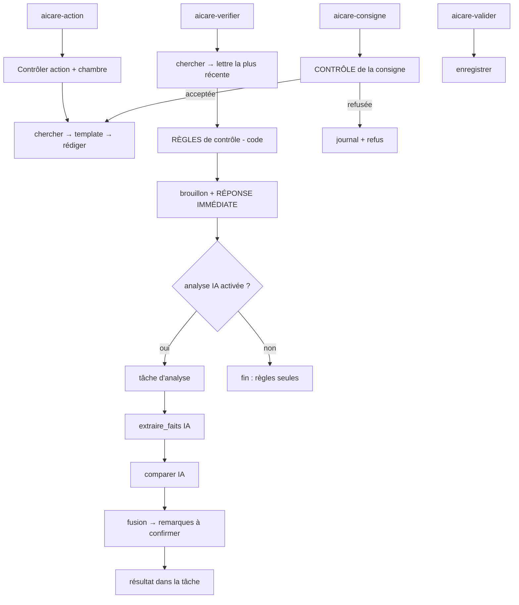

# Interface reliée à n8n

Passer l'interface du mode simulé au mode réel : mettre `VITE_MOCK=false` dans le fichier `.env` à la racine, puis relancer `npm run dev` dans `front/`. Tout passe par `front/src/api.js` ; aucun autre fichier de l'interface ne change selon le mode.

## Trois points d'entrée (webhooks n8n)

| Webhook | Appelé par | Corps de la requête | Réponse |
|---|---|---|---|
| `POST /webhook/aicare-action` | les 4 boutons du Mode A | `{ "action": "rapport_garde", "chambre": "12" }` | un brouillon (voir ci-dessous) |
| `POST /webhook/aicare-consigne` | le Mode B | `{ "chambre": "12", "consigne": "…" }` (300 caractères au plus) | un brouillon, **ou** un refus |
| `POST /webhook/aicare-valider` | le bouton « Valider & Enregistrer » | `{ "brouillon_id": "…", "texte": "…" }` | `{ "ok": true, … }` ou `{ "ok": false, "erreur": "…" }` |

Actions du Mode A : `rapport_garde` (SBAR), `resume_epa`, `points_vigilance`, `verifier_document`. L'action choisit un **prompt caché** (`prompts/*.md`) ; l'interface ne fournit aucun texte, ne choisit ni la période ni les mots de recherche.

### Réponse « brouillon »

```json
{
  "brouillon_id": "b546682d-…",
  "texte": "S – Situation : …",
  "sources": ["Logiciel de soins", "ePA"],
  "alertes": [{ "type": "contradiction", "message": "…" }],
  "avertissements": [{ "type": "phrase_sans_source", "detail": "…" }]
}
```

- `alertes` : bandeau rouge (contradictions entre documents ; alarmes de capteurs dès que MQTT sera relié).
- `avertissements` : « À vérifier avant de valider », contrôles automatiques du texte (voir `docs/briques-ia.md`).
- `brouillon_id` : `null` quand il n'y a rien à enregistrer (ex. aucune lettre à vérifier) ; le bouton de validation disparaît.
- Le texte est un **brouillon** : rien n'est enregistré avant la validation.

### Réponse « refus » (Mode B)

```json
{ "refuse": true, "motif": "regles", "message": "La consigne cherche à modifier les règles de l'assistant : elle est refusée." }
```

Motifs : `longueur`, `format`, `regles`, `mots_interdits`, `autre_resident`. **Rien n'a été envoyé à l'IA.** Le journal garde le motif, la longueur et l'empreinte SHA-256 de la consigne, jamais son texte.

## Ce que fait chaque point d'entrée



### « Vérifier le document » : les règles répondent tout de suite, l'IA suit en tâche de fond

| Webhook | Corps | Réponse |
|---|---|---|
| `POST /webhook/aicare-verifier` | `{ "chambre": "12" }` | **tout de suite** : un brouillon avec le rapport des règles, les alertes, et `analyse: { statut, tache_id }` |
| `POST /webhook/aicare-tache` | `{ "tache_id": "…" }` | `{ statut, resultat: { remarques, alertes, avertissements, indisponible } }` |
| `POST /webhook/aicare-reglage` | `{}` pour lire, `{ "valeur": false }` pour couper l'IA | `{ cle: "verification_ia", valeur: true \| false }` |

1. La lettre en attente la plus récente de la collection `a_verifier` est retrouvée pour le résident (sans lettre : réponse sans brouillon, aucune IA).
2. **Filet de règles** (code, sans IA), appliqué sur le texte de la lettre et les faits du dossier **avant toute réponse** :

| Règle | Déclencheur |
|---|---|
| `allergie` | un médicament de la lettre appartient à une famille dont une allergie est connue (pénicillines, sulfamides) |
| `anticoagulation_double` | un anticoagulant de la lettre alors que le résident en prend déjà un autre, sans arrêt du premier mentionné |
| `insuffisance_renale` | un anti-inflammatoire (AINS) alors que le dossier ou la lettre indique une insuffisance rénale |

3. **Réponse immédiate** : le rapport est rédigé par le code, chaque ligne cite ses sources entre crochets, un brouillon est créé pour qu'il puisse être validé. Le bandeau rouge s'affiche tout de suite.
4. **Analyse complémentaire (IA, en tâche de fond)**, si le réglage `verification_ia` est activé : extraction (`extraire_faits`) puis comparaison (`comparer`). Si une étape échoue, la suivante continue ; si les deux échouent, la tâche se termine en `termine_avec_erreurs` et l'interface dit que l'analyse est indisponible. Les règles ne changent jamais.
5. **Fusion** : ce que l'IA ajoute est une **remarque « à confirmer »**, retenue seulement si elle s'appuie sur un fait réel du dossier et un passage réel de la lettre ; les autres sont écartées et comptées. Les remarques s'affichent à part (« Analyse complémentaire de l'assistant IA ») et leurs alertes s'ajoutent au bandeau ; elles ne modifient pas le texte du brouillon.
6. **Couper l'IA** : `POST /webhook/aicare-reglage {"valeur": false}`, ou la case à cocher du Mode A de l'interface. Sans IA : réponse en quelques secondes, la réponse indique `analyse.statut = "desactivee"` et aucune étape d'IA ne tourne (vérifié par un test de graphe).

Pourquoi des règles en plus de l'IA : Llama 3 (8 milliards de paramètres) a laissé passer l'amoxicilline prescrite à un résident allergique à la pénicilline (voir `docs/prompts-tests.md`).
## Rapport de garde d'un étage, validation et transmission (jour 3, étape 4)

| Webhook | Corps de la requête | Réponse |
|---|---|---|
| `POST /webhook/aicare-etage` | `{ "etage": 2 }` | tout de suite : `{ "tache_id": "…", "total": 4 }` |
| `POST /webhook/aicare-tache` | `{ "tache_id": "…" }` | `{ statut, total, fait, resultat: [ {chambre, resident, brouillon_id, texte, sources, avertissements} ou {chambre, resident, erreur} ] }` |
| `POST /webhook/aicare-valider-lot` | `{ "etage": 2, "rapports": [ {"brouillon_id": "…", "texte": "…"} ] }` | `{ ok, nb_valides, refuses: […], apres_validation: { rag: {ajoutes}, transmission: {statut, destinataire, …} } }` |

`aicare-valider` (un résident) renvoie la même information dans `apres_validation` quand l'action validée est un rapport de garde.

`statut` d'une tâche : `en_cours`, `termine`, `termine_avec_erreurs`. L'interface consulte `aicare-tache` toutes les 4 secondes et affiche chaque rapport dès qu'il est prêt ; elle ne propose « Valider l'étage » qu'une fois la tâche terminée.

```
aicare-etage  → contrôle de l'étage → résidents de l'étage → crée la tâche → RÉPOND → (un résident après l'autre :
                paramètres → chercher → template verrouillé → rédiger → brouillon → avance la tâche) → termine la tâche

aicare-valider-lot → enregistrer (un appel par rapport, brouillon exigé) → rassemble → APRÈS VALIDATION :
                relit les textes validés (table des validations) → ajout au RAG (Indexeur) → message de transmission
                (Mailpit) → note dans soins.transmissions → journal (ajout_rag, transmission)
```

Où voir le résultat : le message dans **Mailpit** (`http://localhost:8025`, sujet « Transmission de garde – étage N »), les points de type `rapport_valide` dans **Qdrant** (collection `patients`), les tables `soins.validations`, `soins.transmissions`, `soins.taches` et `soins.journal_ia` dans **PostgreSQL**.

### Tâches de fond : statuts, annulation, reprise (jour 4, étape 4)

| Webhook | Corps | Réponse |
|---|---|---|
| `POST /webhook/aicare-annuler` | `{ "tache_id": "…" }` | `{ annulee: true \| false, statut }` (`inconnue` si l'identifiant n'existe pas) |

Statuts d'une tâche (`aicare-tache`) : `en_cours`, `termine`, `termine_avec_erreurs`, `interrompue`, `annulee`.

- Un battement de coeur (`heartbeat`) est écrit à chaque étape. Au **démarrage de n8n**, toute tâche « en cours » devient « interrompue » ; toutes les 5 minutes, une tâche sans battement depuis 30 minutes aussi (workflow `80-reprise-taches`).
- L'annulation est prise en compte avant le prochain résident ou la prochaine étape ; la génération déjà en cours chez Ollama se termine et son résultat est abandonné. Une tâche annulée ou interrompue n'est jamais réécrite par un résultat tardif.
- Les rapports déjà préparés restent affichés et validables.
## Garanties vérifiées par des tests

| Garantie | Test |
|---|---|
| Aucun chemin n'envoie le texte du soignant à l'IA sans passer par le contrôle de la consigne, la porte « acceptée » et le template verrouillé | `node tests/chemins-ia.test.mjs` |
| Le contrôle de la consigne refuse longueur, format, mots interdits, tentatives de changer les règles, autre résident | `node tests/consigne.test.mjs` |
| Les contradictions graves sont détectées sans dépendre du modèle | `node tests/regles.test.mjs` |
| « Valider & Enregistrer » n'atteint jamais l'IA ; un brouillon n'est validé qu'une fois | `node tests/chemins-ia.test.mjs`, `node tests/briques.test.mjs` |
| Battement de coeur, annulation, reprise au démarrage, veilleur : une tâche arrêtée ne lance aucune génération et n'est jamais écrasée | `node tests/taches.test.mjs`, `node tests/taches-live.mjs` |
| Seul un rapport de garde validé est ajouté au RAG et transmis ; le texte vient de la table des validations ; un rapport validé n'est pas relu comme fait ; l'étage est un nombre ; aucun nouvel appel à l'IA | `node tests/apres-validation.test.mjs` |

## Essais réels (Llama 3.2, poste de 8 Go sans carte graphique)

| Parcours | Durée | Résultat |
|---|---|---|
| Points de vigilance, M. Wagner | 288 s | texte lisible mais phrase d'introduction interdite et puces sans source : 4 avertissements affichés |
| Vérifier le document, M. Weber (jour 3, avant le jour 4) | 416 s dans le navigateur | **bandeau rouge** : amoxicilline / allergie à la pénicilline (règles) ; validation enregistrée |
| Vérifier le document, Mme Schulz | 363 s | double anticoagulation (apixaban / Marcumar) détectée par les règles |
| Vérifier le document, Mme Fischer | 305 s | une fausse alerte inventée par le modèle a été **écartée** (aucun fait du dossier ne l'appuyait) |
| Consigne acceptée, M. Weber | 157 s | « information non disponible » : exact, la chute des données de test date de plus de 24 h |
| 5 consignes refusées | 2 s au total | aucun appel au modèle, motif enregistré au journal |
| **Jour 4** : Vérifier le document, M. Weber, règles puis analyse IA en tâche de fond | **réponse en 4,1 s** ; analyse IA terminée après 394 s | alerte amoxicilline affichée tout de suite, l'IA n'ajoute aucune remarque |
| **Jour 4** : Vérifier le document, IA désactivée, 5 résidents avec lettre | 1,4 à 9,3 s | 4 contradictions détectées (Schulz, Weber, Wagner, Müller), aucune fausse alerte (Fischer) |
| Rapport de garde, étage 2 (4 résidents), puis validation du lot | 16,3 min pour les 4 rapports (≈ 4 min chacun) | 4 rapports validés, **4 points `rapport_valide` dans Qdrant**, **un message dans Mailpit** (« Transmission de garde – étage 2 »), ligne `soins.transmissions` (envoyé, 4 validations), événements `ajout_rag` et `transmission` au journal ; **seconde validation du même lot refusée (4 refus)**. Qualité du texte : imparfaite (6 à 8 avertissements par rapport : phrases sans source, termes absents des sources, un jugement ajouté, structure SBAR incomplète chez Mme Fischer) : la relecture reste indispensable |

**Données de démonstration** : les notes et constantes fictives sont créées « il y a N heures » au moment du chargement. Pour retrouver une chute « cette nuit » ou des « 12 dernières heures », recharger les données : `cd data` puis `npm run postgres`.

## Limites connues

- **Durée** : un rapport demande 1 à 6 minutes avec Llama 3.2 sur ce poste (sans carte graphique). L'interface attend jusqu'à 20 minutes ; un mécanisme d'attente asynchrone (réponse immédiate puis consultation du résultat) serait nécessaire avec un modèle plus lent.
- **CORS ouvert** (`*`) pour le développement local ; à restreindre à l'adresse de l'interface en production.
- **Pas d'authentification** des soignants : `valide_par` vaut « soignant (non identifié) » tant qu'un identifiant n'est pas fourni.
- **Alarmes de capteurs** : le bandeau rouge est prêt, mais MQTT n'est pas encore relié ; `alertes` ne contient pour l'instant que des contradictions.

## Sécurité des appels (jour 4, étape 7)

Depuis l'étape 7, **chaque appel** de l'interface vers n8n porte deux en-têtes :

- `X-AICare-Cle` : la clé des webhooks (`VITE_N8N_CLE` dans `.env`). Elle filtre les appels qui ne viennent pas de l'interface ; elle est lisible dans le code de l'interface et ne protège donc pas les données à elle seule.
- `Authorization: Bearer <jeton>` : le jeton de session remis à la connexion (`POST aicare-connexion` avec `{identifiant, pin}` → `{jeton, soignant, expire_le}`).

Sans session valide, n8n répond `{ "erreur": "session" }` **avant tout traitement** ; l'interface efface le jeton et rouvre la page de connexion. Le nom du soignant qui valide (`valide_par`) n'est plus envoyé par l'interface : n8n le lit dans la session. Deux points d'entrée s'ajoutent : `aicare-connexion` (clé seule) et `aicare-moi` (soignant de la session ; `{ "deconnexion": true }` ferme la session). Détail, limites : [securite.md](securite.md).
