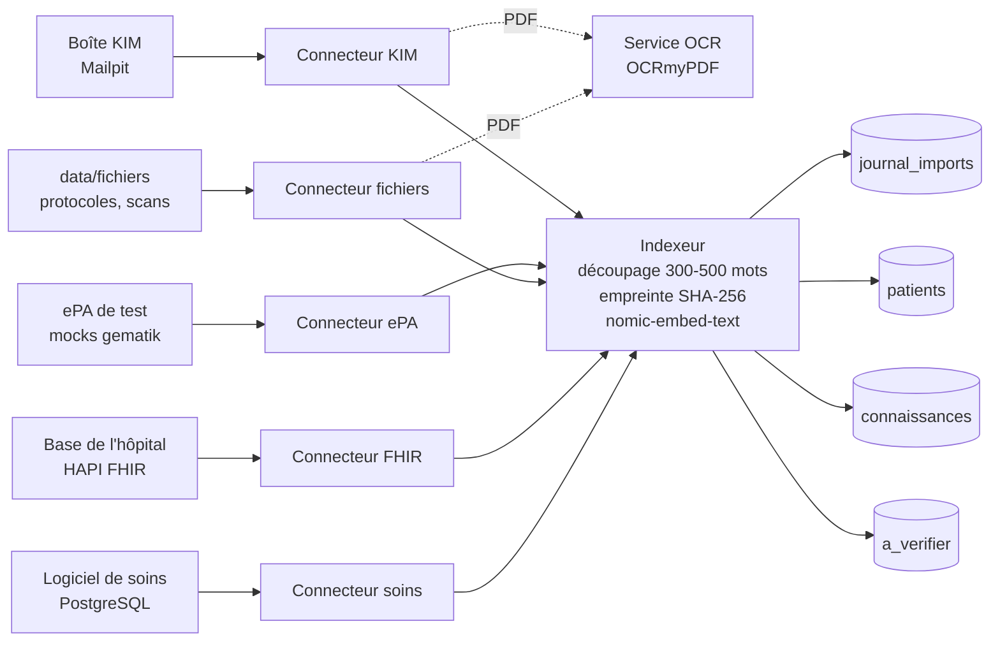

# Schéma du RAG : collections Qdrant et payloads

Le RAG est **une source d'intelligence parmi d'autres** : il rassemble, sous forme de morceaux de texte vectorisés, ce que les connecteurs lisent dans le logiciel de soins, la base de l'hôpital (FHIR), les fichiers, l'ePA de test et la boîte KIM. Toutes les données sont fictives.

## Vue d'ensemble



Chaque connecteur ne fait que produire des **documents** ; l'Indexeur (`workflows/00-indexeur.json`) les découpe, les vectorise et les écrit. Planification : 4 fois par jour (00:00, 06:00, 12:00, 18:00, heure de Berlin), connecteurs décalés de 10 minutes.

## Les trois collections

Toutes : **768 dimensions** (`nomic-embed-text`), distance **Cosine**, `on_disk_payload`.

| Collection | Contenu | Rattachée à un résident ? |
|---|---|---|
| `patients` | morceaux d'information sur un résident : notes de soins, fiche, diagnostics, allergies, médication, analyses, documents scannés identifiés | oui (`patient_id`) |
| `connaissances` | protocoles de la maison (chutes, hypoglycémie, escarres, anticoagulants, AINS et rein) | non |
| `a_verifier` | documents entrants à **contrôler avant d'être considérés comme fiables** : lettres de médecin (KIM) et tout document dont l'identité du résident n'est pas certaine | oui si l'identité est certaine, sinon non |

Une seule collection `patients` filtrée par `patient_id` (plutôt qu'une collection par résident) : plus simple à interroger et à planifier.

### Index de payload

| Champ | Type | `patients` | `connaissances` | `a_verifier` |
|---|---|:-:|:-:|:-:|
| `source` | keyword | ✔ | ✔ | ✔ |
| `type` | keyword | ✔ | ✔ | ✔ |
| `empreinte` | keyword | ✔ | ✔ | ✔ |
| `date` | datetime | ✔ | ✔ | ✔ |
| `patient_id` | keyword | ✔ | | ✔ |
| `chambre` | keyword | ✔ | | |
| `theme` | keyword | | ✔ | |
| `statut` | keyword | | | ✔ |
| `motif` | keyword | | | ✔ |

Créés par `data/scripts/creer-collections.mjs` (`npm run qdrant`, rejouable, ne supprime rien).

## Le payload d'un point

| Champ | Type | Présent | Rôle |
|---|---|---|---|
| `patient_id` | texte (`PAT-003`) | si résident connu | **identifiant unique** du résident, commun à tous les systèmes (voir « Correspondance ») |
| `chambre` | texte (`"12"`) | si résident connu | chambre du résident |
| `source` | texte | toujours | origine technique : `logiciel_soins`, `fhir`, `epa`, `fichier`, `kim` |
| `source_label` | texte | toujours | **libellé affiché entre crochets** dans les réponses : `[Logiciel de soins]`, `[Base hôpital (FHIR)]`, `[ePA]`, `[Fichiers]`, `[KIM (lettre de médecin)]` |
| `source_ref` | texte | toujours | référence stable du document d'origine (voir tableau ci-dessous) |
| `type` | texte | toujours | nature : `note`, `fiche`, `diagnostic`, `allergie`, `medication`, `analyse`, `document`, `protocole`, `lettre` |
| `titre` | texte | toujours | titre court du document |
| `date` | date ISO 8601 (UTC) | sauf protocoles | date **de l'information** (pas de l'import) : sert au filtre « 12 dernières heures » |
| `texte` | texte | toujours | le morceau, tel qu'il sera cité |
| `chunk_index` / `chunk_total` | entiers | toujours | rang du morceau et nombre de morceaux du document |
| `mots` | entier | toujours | longueur du morceau |
| `empreinte` | SHA-256 (hex) | toujours | empreinte du contenu, pour l'anti-doublon |
| `theme` | texte | protocoles | ex. `chutes`, `escarres` |
| `statut` | texte | `a_verifier` | `a_verifier` (le contrôle viendra au jour 3 : `confirme` ou `rejete`) |
| `motif` | texte | `a_verifier` | `lettre_a_verifier`, `identite_inconnue`, `identite_ambigue` |
| `expediteur` | texte | lettres KIM | nom de l'expéditeur du courrier |

### Identifiant du point et empreinte

- **`id` (UUID stable)** = hash SHA-256 de `source|source_ref|chunk_index`, mis en forme d'UUID. Importer deux fois le même document **écrase le même point** : jamais de doublon, même si le journal était vidé.
- **`empreinte`** = SHA-256 de `id|texte|date|patient_id|type`. Si le contenu change, l'empreinte change : le morceau est ré-importé et remplace l'ancien point.

### Texte vectorisé

Le vecteur n'est pas calculé sur `texte` seul mais sur :

```
search_document: <patient_label> – <titre>
<morceau>
```

Le préfixe `search_document:` est celui attendu par `nomic-embed-text` (la requête, elle, commence par `search_query:`). Le nom et la chambre du résident sont ajoutés pour que « M. Weber chute » retrouve les morceaux de M. Weber. `patient_label` n'est **pas** stocké dans le payload.

### Découpage

- Un document de **500 mots ou moins reste un seul morceau** : une note de soins garde donc sa date exacte.
- Au-delà : morceaux de **300 à 500 mots** (cible 400), coupés sur les phrases ; un dernier morceau trop court est rattaché au précédent si la limite le permet ; une phrase de plus de 500 mots est coupée de force.

## Ce que produit chaque connecteur

| Connecteur | Collection | `source` | `type` | `source_ref` | `date` | Un document = |
|---|---|---|---|---|---|---|
| Logiciel de soins | `patients` | `logiciel_soins` | `note` | `note-<id>` | horodatage de la note | une note de soins |
| | `patients` | `logiciel_soins` | `fiche` | `fiche-<patient_id>` | dernière constante vitale | la fiche du résident (diagnostics, allergies, régime, risques, médication, constantes) |
| Base de l'hôpital (FHIR) | `patients` | `fhir` | `diagnostic`, `allergie`, `medication`, `analyse` | `<id FHIR>/<Condition\|AllergyIntolerance\|MedicationStatement\|Observation>` | plus récent `meta.lastUpdated` | toutes les ressources d'un type pour un résident |
| ePA de test | `patients` | `epa` | `diagnostic`, `medication` | `epa/<KVNR>/diagnostics` ou `epa/<KVNR>/eml` | `lastUpdated` / dernière ordonnance | diagnostics, ou liste de médication (eML), d'un résident |
| Fichiers | `connaissances` | `fichier` | `protocole` | `fichiers/<nom>` | — | un protocole (`protocole-*.md`) |
| | `patients` | `fichier` | `document` | `fichiers/<nom>` | date lue dans le document | un document scanné (OCR) dont le résident est identifié |
| | `a_verifier` | `fichier` | `document` | `fichiers/<nom>` | idem | un document dont l'identité est inconnue ou ambiguë |
| KIM | `a_verifier` | `kim` | `lettre` | `kim/<expéditeur>/<fichier>` | date du courrier | une lettre de médecin (PDF, texte ou OCR) |
| Après validation (jour 3) | `patients` | `validation` | `rapport_valide` | `validation-<id>` | date de validation | un rapport de garde relu et validé par un soignant. **Pas un fait source** : « chercher » l'ignore pour écrire un nouveau rapport, seul le Mode B le relit (source « Rapport validé ») |

### Règle d'identification des documents (scans et lettres)

Un document n'est rattaché à un résident que si **le nom ET la date de naissance** (`jj.mm.aaaa`) qu'il contient correspondent à **un seul** résident. Les deux « Heinz Müller » ne se distinguent que par la date. Sinon le document n'est **jamais deviné** : il est rangé dans `a_verifier` avec le motif `identite_inconnue` ou `identite_ambigue`.

Les lettres KIM vont **toujours** dans `a_verifier` (statut `a_verifier`, motif `lettre_a_verifier` quand l'identité est certaine), même sans contradiction : leur contenu n'est pas présenté comme fiable avant contrôle (jour 3).

## Exemples de payloads

Note de soins (`patients`) :

```json
{
  "patient_id": "PAT-002",
  "chambre": "11",
  "source": "logiciel_soins",
  "source_label": "Logiciel de soins",
  "source_ref": "note-7",
  "type": "note",
  "titre": "Note de soins (observation) par AS Braun",
  "date": "2026-10-22T23:02:08.960Z",
  "texte": "Nuit : toux, installé en position semi-assise, SpO2 93 %.",
  "chunk_index": 0,
  "chunk_total": 1,
  "mots": 10,
  "empreinte": "668da7bd585e61230c590060e0fec450296b9efddbb876c90d5bcb8ff2b95d8d"
}
```

Liste de médication de l'ePA (`patients`) :

```json
{
  "patient_id": "PAT-001",
  "chambre": "10",
  "source": "epa",
  "source_label": "ePA",
  "source_ref": "epa/Z000000010/eml",
  "type": "medication",
  "titre": "Liste de médication eML (ePA)",
  "date": "2026-09-23T10:37:47.108Z",
  "texte": "Liste de médication (eML) du dossier ePA de Mme Greta Schulz (chambre 10) :\n- Bisoprolol : 2,5 mg, 1-0-0 …\n- Marcumar (phenprocoumon) : 3 mg, le soir, selon INR …",
  "chunk_index": 0,
  "chunk_total": 1,
  "mots": 64,
  "empreinte": "ee592bd6…"
}
```

Protocole (`connaissances`) : pas de `patient_id`, ni de `date`.

```json
{
  "theme": "escarres",
  "source": "fichier",
  "source_label": "Fichiers",
  "source_ref": "fichiers/protocole-escarres.md",
  "type": "protocole",
  "titre": "protocole escarres",
  "texte": "# Protocole : prévention et prise en charge des escarres …",
  "chunk_index": 0,
  "chunk_total": 1,
  "mots": 192,
  "empreinte": "defa5786…"
}
```

Lettre de médecin (`a_verifier`) :

```json
{
  "patient_id": "PAT-003",
  "chambre": "12",
  "source": "kim",
  "source_label": "KIM (lettre de médecin)",
  "source_ref": "kim/praxis-berger@kim.example.test/arztbrief-weber.pdf",
  "type": "lettre",
  "titre": "Arztbrief – Hans Weber, geb. 23.11.1941",
  "expediteur": "Dr. med. Annika Berger",
  "statut": "a_verifier",
  "motif": "lettre_a_verifier",
  "date": "2026-10-23T…Z",
  "texte": "Dr. med. Annika Berger … Therapie: Amoxicillin 1000 mg, 1-0-1, über 7 Tage …",
  "chunk_index": 0,
  "chunk_total": 1,
  "mots": 95,
  "empreinte": "…"
}
```

## Interroger le RAG

1. Vectoriser la question avec Ollama : `POST /api/embed` `{"model": "nomic-embed-text", "input": "search_query: M. Weber chute"}` (le vecteur est `embeddings[0]`).
2. Chercher : `POST /collections/patients/points/search` avec `vector`, `limit`, `with_payload: true` et un filtre.

Filtre « M. Weber, 12 dernières heures » (`date` est indexé en `datetime`, la valeur est une date ISO) :

```json
{
  "filter": {
    "must": [
      { "key": "patient_id", "match": { "value": "PAT-003" } },
      { "key": "date", "range": { "gte": "2026-10-23T01:07:14Z" } }
    ]
  }
}
```

Un résident se trouve par chambre (`chambre`), jamais par son nom : le nom n'est pas un champ du payload.
Pour la réponse affichée aux soignants, on cite `source_label` entre crochets.
Exemple vérifié : « M. Weber chute » renvoie des morceaux du logiciel de soins, de l'ePA et de la base de l'hôpital ; une recherche dans `connaissances` retrouve le protocole des chutes.

## Tables PostgreSQL liées (schéma `soins`)

### Correspondance des identifiants

Un seul `patient_id` pour tous les systèmes. Table `soins.correspondance(patient_id, systeme, identifiant)`, vue à plat `soins.v_correspondance`.

| `patient_id` | Chambre | Identifiant FHIR | KVNR (ePA, fictif) | Capteur (LoRaWAN) |
|---|---|---|---|---|
| PAT-001 | 10 | `aicare-schulz` | `Z000000010` | `lora-lit-010` |
| PAT-002 | 11 | `aicare-mueller-1` | `Z000000011` | `lora-lit-011` |
| PAT-003 | 12 | `aicare-weber` | `Z000000012` | `lora-lit-012` |
| PAT-004 | 14 | `aicare-becker` | `Z000000014` | `lora-lit-014` |
| PAT-005 | 20 | `aicare-wagner` | `Z000000020` | `lora-lit-020` |
| PAT-006 | 21 | `aicare-mueller-2` | `Z000000021` | `lora-lit-021` |
| PAT-007 | 22 | `aicare-fischer` | `Z000000022` | `lora-lit-022` |
| PAT-008 | 23 | `aicare-hoffmann` | `Z000000023` | `lora-lit-023` |

Fonctions : `soins.resoudre_patient(système, identifiant)` (ex. `('epa_kvnr', 'Z000000012')` donne `PAT-003`) et `soins.trouver_par_identite(nom, date de naissance)` (0 ligne si inconnu, plusieurs si ambigu : l'appelant range alors le document dans `a_verifier`).

### Journal des imports : `soins.journal_imports`

| Colonne | Rôle |
|---|---|
| `source` | `logiciel_soins`, `fhir`, `epa`, `fichier`, `kim` |
| `reference` | `source_ref#numéro de morceau` |
| `patient_id` | résident concerné (peut être vide) |
| `empreinte` | SHA-256 du contenu ; `UNIQUE (source, empreinte)` |
| `statut`, `detail` | `importe` ; `collection / type` |
| `importe_le` | date de l'import |

Une ligne est écrite **après** le succès de l'écriture dans Qdrant. Avant d'embedder, l'Indexeur retire les morceaux dont l'empreinte est déjà au journal. Un morceau modifié a une nouvelle empreinte : il est ré-importé (nouvelle ligne, l'ancienne reste comme historique).

### Réponses validées : `soins.validations`

Rempli par le bouton « Valider & Enregistrer » (jour 3) : `patient_id`, `mode`, `action`, `consigne`, `texte`, `sources`, `modifiee`, `valide_par`, `valide_le`.

## Pour vérifier

```bash
node tests/test-du-soir.mjs
```

Lance 3 passages des 5 connecteurs et vérifie : aucun doublon, journal stable, passages 2 et 3 sans rien importer, « M. Weber chute » sur au moins 3 sources, les 5 lettres KIM rattachées au bon résident.
