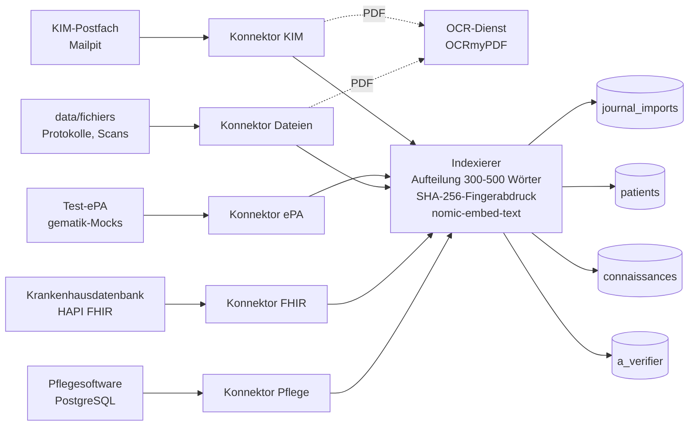

# Schema des RAG: Qdrant-Collections und Payloads

Das RAG ist **eine Intelligenzquelle unter mehreren**: Es sammelt, in Form vektorisierter Textabschnitte, was die Konnektoren aus der Pflegesoftware, der Krankenhausdatenbank (FHIR), den Dateien, der Test-ePA und dem KIM-Postfach lesen. Alle Daten sind fiktiv.

## Überblick



Jeder Konnektor erzeugt nur **Dokumente**; der Indexeur (`workflows/00-indexeur.json`) teilt sie auf, vektorisiert sie und schreibt sie. Planung: 4-mal täglich (00:00, 06:00, 12:00, 18:00, Berliner Zeit), Konnektoren um 10 Minuten versetzt.

## Die drei Collections

Alle: **768 Dimensionen** (`nomic-embed-text`), Distanz **Cosine**, `on_disk_payload`.

| Collection | Inhalt | Einer Person zugeordnet? |
|---|---|---|
| `patients` | Informationsabschnitte zu einer Person: Pflegenotizen, Akte, Diagnosen, Allergien, Medikation, Analysen, identifizierte gescannte Dokumente | ja (`patient_id`) |
| `connaissances` | Protokolle des Hauses (Stürze, Hypoglykämie, Dekubitus, Antikoagulanzien, NSAR und Niere) | nein |
| `a_verifier` | eingehende Dokumente, die **vor ihrer Behandlung als verlässlich zu prüfen sind**: Arztbriefe (KIM) und jedes Dokument, dessen Identität der Person nicht sicher ist | ja, wenn die Identität sicher ist, sonst nein |

Eine einzige Collection `patients`, nach `patient_id` gefiltert (statt einer Collection pro Person): einfacher abzufragen und zu planen.

### Payload-Indizes

| Feld | Typ | `patients` | `connaissances` | `a_verifier` |
|---|---|:-:|:-:|:-:|
| `source` | keyword | ✔ | ✔ | ✔ |
| `type` | keyword | ✔ | ✔ | ✔ |
| `empreinte` | keyword | ✔ | ✔ | ✔ |
| `date` | datetime | ✔ | ✔ | ✔ |
| `patient_id` | keyword | ✔ | | ✔ |
| `chambre` | keyword | ✔ | | |
| `theme` | keyword | | ✔ | |
| `statut` | keyword | | | ✔ |
| `motif` | keyword | | | ✔ |

Angelegt von `data/scripts/creer-collections.mjs` (`npm run qdrant`, wiederholbar, löscht nichts).

## Der Payload eines Punktes

| Feld | Typ | Vorhanden | Aufgabe |
|---|---|---|---|
| `patient_id` | Text (`PAT-003`) | wenn die Person bekannt ist | **eindeutige Kennung** der Person, allen Systemen gemeinsam (siehe « Zuordnung ») |
| `chambre` | Text (`"12"`) | wenn die Person bekannt ist | Zimmer der Person |
| `source` | Text | immer | technische Herkunft: `logiciel_soins`, `fhir`, `epa`, `fichier`, `kim` |
| `source_label` | Text | immer | **in den Antworten in eckigen Klammern angezeigte Bezeichnung**: `[Pflegesoftware]`, `[Krankenhausdatenbank (FHIR)]`, `[ePA]`, `[Dateien]`, `[KIM (Arztbrief)]` |
| `source_ref` | Text | immer | stabile Referenz des Ursprungsdokuments (siehe Tabelle unten) |
| `type` | Text | immer | Art: `note`, `fiche`, `diagnostic`, `allergie`, `medication`, `analyse`, `document`, `protocole`, `lettre` |
| `titre` | Text | immer | kurzer Titel des Dokuments |
| `date` | ISO-8601-Datum (UTC) | außer Protokolle | Datum **der Information** (nicht des Imports): dient dem Filter « letzte 12 Stunden » |
| `texte` | Text | immer | der Abschnitt, so wie er zitiert wird |
| `chunk_index` / `chunk_total` | ganze Zahlen | immer | Rang des Abschnitts und Anzahl der Abschnitte des Dokuments |
| `mots` | ganze Zahl | immer | Länge des Abschnitts |
| `empreinte` | SHA-256 (hex) | immer | Fingerabdruck des Inhalts für die Duplikatsperre |
| `theme` | Text | Protokolle | z. B. `chutes`, `escarres` |
| `statut` | Text | `a_verifier` | `a_verifier` (die Prüfung folgt an Tag 3: `confirme` oder `rejete`) |
| `motif` | Text | `a_verifier` | `lettre_a_verifier`, `identite_inconnue`, `identite_ambigue` |
| `expediteur` | Text | KIM-Briefe | Name des Absenders des Briefs |

### Kennung des Punktes und Fingerabdruck

- **`id` (stabile UUID)** = SHA-256-Hash von `source|source_ref|chunk_index`, in UUID-Form gebracht. Dasselbe Dokument zweimal zu importieren **überschreibt denselben Punkt**: nie ein Duplikat, selbst wenn das Journal geleert wurde.
- **`empreinte`** = SHA-256 von `id|texte|date|patient_id|type`. Ändert sich der Inhalt, ändert sich der Fingerabdruck: Der Abschnitt wird erneut importiert und ersetzt den alten Punkt.

### Vektorisierter Text

Der Vektor wird nicht allein auf `texte` berechnet, sondern auf:

```
search_document: <patient_label> – <titre>
<morceau>
```

Das Präfix `search_document:` ist das von `nomic-embed-text` erwartete (die Anfrage beginnt dagegen mit `search_query:`). Name und Zimmer der Person werden hinzugefügt, damit « Herr Weber Sturz » die Abschnitte von Herrn Weber wiederfindet. `patient_label` wird **nicht** im Payload gespeichert.

### Aufteilung

- Ein Dokument mit **500 Wörtern oder weniger bleibt ein einziger Abschnitt**: Eine Pflegenotiz behält also ihr genaues Datum.
- Darüber: Abschnitte von **300 bis 500 Wörtern** (Ziel 400), an Satzgrenzen geschnitten; ein zu kurzer letzter Abschnitt wird an den vorigen angehängt, wenn die Grenze es erlaubt; ein Satz von mehr als 500 Wörtern wird zwangsweise getrennt.

## Was jeder Konnektor erzeugt

| Konnektor | Collection | `source` | `type` | `source_ref` | `date` | Ein Dokument = |
|---|---|---|---|---|---|---|
| Pflegesoftware | `patients` | `logiciel_soins` | `note` | `note-<id>` | Zeitstempel der Notiz | eine Pflegenotiz |
| | `patients` | `logiciel_soins` | `fiche` | `fiche-<patient_id>` | letzter Vitalwert | die Akte der Person (Diagnosen, Allergien, Kost, Risiken, Medikation, Vitalwerte) |
| Krankenhausdatenbank (FHIR) | `patients` | `fhir` | `diagnostic`, `allergie`, `medication`, `analyse` | `<id FHIR>/<Condition\|AllergyIntolerance\|MedicationStatement\|Observation>` | jüngstes `meta.lastUpdated` | alle Ressourcen eines Typs für eine Person |
| Test-ePA | `patients` | `epa` | `diagnostic`, `medication` | `epa/<KVNR>/diagnostics` oder `epa/<KVNR>/eml` | `lastUpdated` / letzte Verordnung | Diagnosen oder Medikationsliste (eML) einer Person |
| Dateien | `connaissances` | `fichier` | `protocole` | `fichiers/<nom>` | — | ein Protokoll (`protocole-*.md`) |
| | `patients` | `fichier` | `document` | `fichiers/<nom>` | im Dokument gelesenes Datum | ein gescanntes Dokument (OCR), dessen Person identifiziert ist |
| | `a_verifier` | `fichier` | `document` | `fichiers/<nom>` | dito | ein Dokument mit unbekannter oder mehrdeutiger Identität |
| KIM | `a_verifier` | `kim` | `lettre` | `kim/<from>/<fileName>` | Datum des Briefs | ein Arztbrief (PDF, Text oder OCR) |
| Nach der Validierung (Tag 3) | `patients` | `validation` | `rapport_valide` | `validation-<id>` | Datum der Validierung | ein von einer Pflegekraft gegengelesener und validierter Dienstbericht. **Kein Quellfakt**: « Suchen » ignoriert ihn beim Schreiben eines neuen Berichts, nur Modus B liest ihn erneut (Quelle « Bestätigter Bericht ») |

### Identifizierungsregel für Dokumente (Scans und Briefe)

Ein Dokument wird einer Person nur zugeordnet, wenn **Name UND Geburtsdatum** (`tt.mm.jjjj`), die es enthält, **genau einer** Person entsprechen. Die beiden « Heinz Müller » unterscheiden sich nur durch das Datum. Sonst wird das Dokument **nie erraten**: Es wird mit dem Grund `identite_inconnue` oder `identite_ambigue` in `a_verifier` abgelegt.

KIM-Briefe kommen **immer** in `a_verifier` (Status `a_verifier`, Grund `lettre_a_verifier`, wenn die Identität sicher ist), auch ohne Widerspruch: Ihr Inhalt wird vor der Prüfung nicht als verlässlich dargestellt (Tag 3).

## Beispiele für Payloads

Pflegenotiz (`patients`):

```json
{
  "patient_id": "PAT-002",
  "chambre": "11",
  "source": "logiciel_soins",
  "source_label": "Pflegesoftware",
  "source_ref": "note-7",
  "type": "note",
  "titre": "Pflegenotiz (observation) von PH Braun",
  "date": "2026-10-22T23:02:08.960Z",
  "texte": "Nacht: Husten, in halbsitzender Position gelagert, SpO2 93 %.",
  "chunk_index": 0,
  "chunk_total": 1,
  "mots": 10,
  "empreinte": "668da7bd585e61230c590060e0fec450296b9efddbb876c90d5bcb8ff2b95d8d"
}
```

Medikationsliste der ePA (`patients`):

```json
{
  "patient_id": "PAT-001",
  "chambre": "10",
  "source": "epa",
  "source_label": "ePA",
  "source_ref": "epa/Z000000010/eml",
  "type": "medication",
  "titre": "Medikationsliste eML (ePA)",
  "date": "2026-09-23T10:37:47.108Z",
  "texte": "Medikationsliste (eML) aus der ePA-Akte von Frau Greta Schulz (Zimmer 10):\n- Bisoprolol: 2,5 mg, 1-0-0 …\n- Marcumar (phenprocoumon): 3 mg, abends, nach INR …",
  "chunk_index": 0,
  "chunk_total": 1,
  "mots": 64,
  "empreinte": "ee592bd6…"
}
```

Protokoll (`connaissances`): kein `patient_id` und kein `date`.

```json
{
  "theme": "escarres",
  "source": "fichier",
  "source_label": "Dateien",
  "source_ref": "fichiers/protocole-escarres.md",
  "type": "protocole",
  "titre": "Protokoll Dekubitus",
  "texte": "# Protokoll: Vorbeugung und Versorgung von Dekubitus …",
  "chunk_index": 0,
  "chunk_total": 1,
  "mots": 192,
  "empreinte": "defa5786…"
}
```

Arztbrief (`a_verifier`):

```json
{
  "patient_id": "PAT-003",
  "chambre": "12",
  "source": "kim",
  "source_label": "KIM (Arztbrief)",
  "source_ref": "kim/praxis-berger@kim.example.test/arztbrief-weber.pdf",
  "type": "lettre",
  "titre": "Arztbrief – Hans Weber, geb. 23.11.1941",
  "expediteur": "Dr. med. Annika Berger",
  "statut": "a_verifier",
  "motif": "lettre_a_verifier",
  "date": "2026-10-23T…Z",
  "texte": "Dr. med. Annika Berger … Therapie: Amoxicillin 1000 mg, 1-0-1, über 7 Tage …",
  "chunk_index": 0,
  "chunk_total": 1,
  "mots": 95,
  "empreinte": "…"
}
```

## Das RAG abfragen

1. Die Frage mit Ollama vektorisieren: `POST /api/embed` `{"model": "nomic-embed-text", "input": "search_query: Herr Weber Sturz"}` (der Vektor ist `embeddings[0]`).
2. Suchen: `POST /collections/patients/points/search` mit `vector`, `limit`, `with_payload: true` und einem Filter.

Filter « Herr Weber, letzte 12 Stunden » (`date` ist als `datetime` indexiert, der Wert ist ein ISO-Datum):

```json
{
  "filter": {
    "must": [
      { "key": "patient_id", "match": { "value": "PAT-003" } },
      { "key": "date", "range": { "gte": "2026-10-23T01:07:14Z" } }
    ]
  }
}
```

Eine Person wird über das Zimmer (`chambre`) gefunden, niemals über ihren Namen: Der Name ist kein Feld des Payloads.
Für die den Pflegekräften angezeigte Antwort wird `source_label` in eckigen Klammern zitiert.
Geprüftes Beispiel: « Herr Weber Sturz » liefert Abschnitte der Pflegesoftware, der ePA und der Krankenhausdatenbank; eine Suche in `connaissances` findet das Sturzprotokoll.

## Verknüpfte PostgreSQL-Tabellen (Schema `soins`)

### Zuordnung der Kennungen

Eine einzige `patient_id` für alle Systeme. Tabelle `soins.correspondance(patient_id, systeme, identifiant)`, flache Sicht `soins.v_correspondance`.

| `patient_id` | Zimmer | FHIR-Kennung | KVNR (ePA, fiktiv) | Sensor (LoRaWAN) |
|---|---|---|---|---|
| PAT-001 | 10 | `aicare-schulz` | `Z000000010` | `lora-lit-010` |
| PAT-002 | 11 | `aicare-mueller-1` | `Z000000011` | `lora-lit-011` |
| PAT-003 | 12 | `aicare-weber` | `Z000000012` | `lora-lit-012` |
| PAT-004 | 14 | `aicare-becker` | `Z000000014` | `lora-lit-014` |
| PAT-005 | 20 | `aicare-wagner` | `Z000000020` | `lora-lit-020` |
| PAT-006 | 21 | `aicare-mueller-2` | `Z000000021` | `lora-lit-021` |
| PAT-007 | 22 | `aicare-fischer` | `Z000000022` | `lora-lit-022` |
| PAT-008 | 23 | `aicare-hoffmann` | `Z000000023` | `lora-lit-023` |

Funktionen: `soins.resoudre_patient(systeme, identifiant)` (z. B. liefert `('epa_kvnr', 'Z000000012')` `PAT-003`) und `soins.trouver_par_identite(nom, naissance)` (0 Zeilen, wenn unbekannt, mehrere, wenn mehrdeutig: Der Aufrufer legt das Dokument dann in `a_verifier` ab).

### Import-Journal: `soins.journal_imports`

| Spalte | Aufgabe |
|---|---|
| `source` | `logiciel_soins`, `fhir`, `epa`, `fichier`, `kim` |
| `reference` | `source_ref#Nummer des Abschnitts` |
| `patient_id` | betroffene Person (kann leer sein) |
| `empreinte` | SHA-256 des Inhalts; `UNIQUE (source, empreinte)` |
| `statut`, `detail` | `importe`; `collection / type` |
| `importe_le` | Datum des Imports |

Eine Zeile wird **nach** erfolgreichem Schreiben in Qdrant geschrieben. Vor dem Embedding entfernt der Indexeur die Abschnitte, deren Fingerabdruck bereits im Journal steht. Ein geänderter Abschnitt hat einen neuen Fingerabdruck: Er wird erneut importiert (neue Zeile, die alte bleibt als Verlauf).

### Validierte Antworten: `soins.validations`

Gefüllt von der Schaltfläche « Bestätigen & Speichern » (Tag 3): `patient_id`, `mode`, `action`, `consigne`, `texte`, `sources`, `modifiee`, `valide_par`, `valide_le`.

## Zum Überprüfen

```bash
node tests/test-du-soir.mjs
```

Startet 3 Durchläufe der 5 Konnektoren und prüft: kein Duplikat, stabiles Journal, Durchläufe 2 und 3 ohne Import, « Herr Weber Sturz » über mindestens 3 Quellen, die 5 KIM-Briefe der richtigen Person zugeordnet.
